# Architecture Design Document: Repository Intelligence Platform

**Modes:** GitFlow · GitExplain · GitTime **Status:** Technical blueprint, v1.1 (GitFlow-first public entry via `gitflow.com/user/repo`) **Audience:** Founding developer(s) and AI coding agents

---

## 1. Executive Summary

We are building **one platform** that analyzes a GitHub repository once, stores the result as a **Repository Intelligence Graph (RIG)**, and exposes it through three views:

- **GitFlow**: how a request or action travels through the code.
- **GitExplain**: what a file, class, or function does and how it connects to its surroundings.
- **GitTime**: how the architecture evolved through Git history.

The RIG is the central asset. Analysis is deterministic first (parsers, symbol resolution, framework adapters, Git history). LLMs sit on top to select, summarize, and explain, and never invent graph facts. Every edge carries **provenance** (extracted / inferred / LLM) and **confidence**.

**First milestone:** given a real public repository, reliably identify and visualize one meaningful application flow with every step linked to real source code.

**Primary public entry (core requirement):** GitFlow is the default product experience. A user viewing `github.com/user/repo` replaces `github.com` with `gitflow.com` and lands directly in GitFlow at `gitflow.com/user/repo`. The URL alone identifies the repository: no signup, no file upload, no GitHub authorization. The system fetches and analyzes the repository automatically. GitExplain and GitTime are additional modes on the same Repository Intelligence Graph, reachable from inside that experience. The official website (paste a URL, product pages, docs) remains, but is secondary to this direct URL path. Private repositories still require GitHub authorization (section 20).

**Key recommendations**

| Decision | Recommendation |
| --- | --- |
| Shape | Modular monolith + one analysis worker. No microservices. |
| Language | TypeScript end to end (web, API, worker, shared contracts). |
| Parsing | tree-sitter for syntax, plus language-native resolvers where precision matters. |
| Graph store | PostgreSQL (nodes/edges tables + JSONB). No graph database in MVP. |
| Jobs | Postgres-backed queue (pg-boss), moving to a dedicated queue only if needed. |
| Snapshots | Graph is **keyed by commit SHA**, which makes caching, sharing, and GitTime fall out naturally. |
| First languages | TypeScript/JavaScript (Express, NestJS, Fastify) first; Python (FastAPI, Flask, Django) second. |
| Public entry | `github.com/user/repo` → `gitflow.com/user/repo`, landing directly in GitFlow. Auto-ingest on first visit, no signup or auth. |

---

## 2. Product Scope

**In scope (product vision)**

- **Primary public entry:** replace `github.com` with `gitflow.com` in any public repository URL (`gitflow.com/user/repo`) and land directly in GitFlow for that repository. This is a core product requirement, not an optional deep-link feature.
- **Minimal friction for public repos:** no signup, no manual upload, no GitHub authorization. The URL alone identifies the repository, and fetching and analysis happen automatically.
- Three modes sharing one backend and one graph, with GitFlow as the default.
- An official website where users can paste a GitHub URL, discover the product, learn about GitFlow, GitExplain, and GitTime, and read documentation. This is secondary to the direct URL path.
- Shareable deep links to a repo, a flow, a symbol explanation, or a point in history.
- Optional GitHub-side shortcuts (browser extension or bookmarklet) later, layered on top of the URL-replacement entry.
- Private repositories via GitHub OAuth / GitHub App later. Replacing the URL cannot grant access to private code, so authorization remains required there.

**Product positioning**

| Mode | Role | Built on |
| --- | --- | --- |
| **GitFlow** | Primary and default experience; public-repository entry point | Repository Intelligence Graph |
| **GitExplain** | Code, function, and file understanding | Same graph |
| **GitTime** | Repository evolution and history | Same graph |

There are no separate codebases and no independent analysis pipelines.

**In scope for MVP** (see section 44): public repos via `gitflow.com/user/repo`, 1 to 2 languages, GitFlow first, a basic GitExplain panel, schema ready for GitTime.

---

## 3. Architectural Goals

1. **Analyze once, reuse everywhere.** No mode runs its own analysis.
2. **Source-grounded.** Every node and edge resolves to a file and line range at a specific commit.
3. **Honest about certainty.** Facts, inferences, and LLM text are visibly different.
4. **Fast MVP.** Reach the first milestone with the fewest moving parts.
5. **AI-agent friendly.** Small modules, strict typed contracts, strong tests, so coding agents can work safely.
6. **Language-extensible.** New language = new plugin, not a core change.
7. **Security from day one.** Untrusted code is analyzed, never executed; tenant boundaries exist before private repos ship.
8. **Deterministic and reproducible.** Same commit + same analyzer version = same graph.
9. **Zero-friction public entry.** For public repositories, `gitflow.com/user/repo` must work with nothing but the URL: no signup, upload, or GitHub authorization.

---

## 4. Non-goals

- Supporting many languages in v1.
- Executing repository code, running tests, or dynamic tracing.
- Full type inference or a whole-program compiler for every ecosystem.
- Real-time collaboration, comments, or team workspaces.
- Enterprise features (SSO, audit exports, on-prem) in MVP.
- Separate codebases or infrastructure per mode.
- A graph database, vector database, or Kubernetes in MVP.
- Code editing or PR generation.

---

## 5. High-level System Architecture

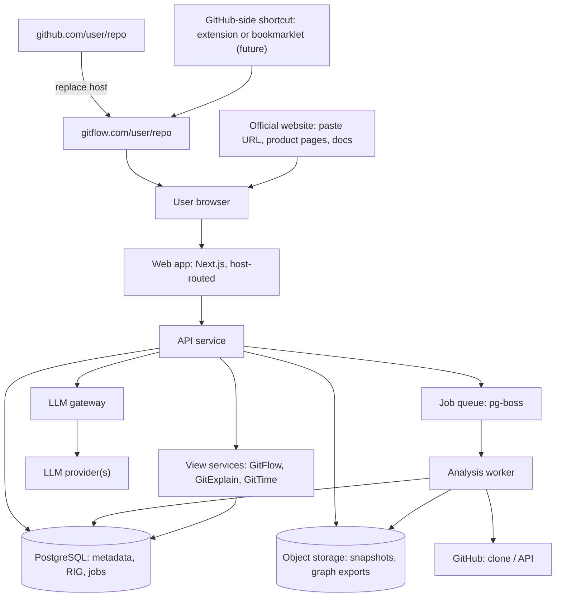

The **view services** are modules inside the API, not deployables. They read the RIG and never re-parse code. **GitFlow is the default view**; GitExplain and GitTime are reached from within it.

**Primary public journey**

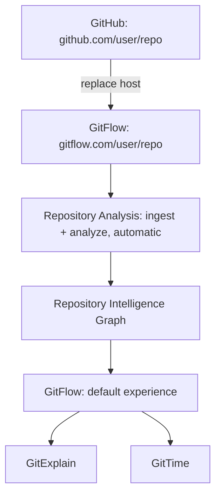

---

## 6. Major Components

| Component | Responsibility | Inputs | Outputs | Depends on | Why it exists | Consumed by |
| --- | --- | --- | --- | --- | --- | --- |
| **Web app** | UI, graph rendering, source viewer, timeline; serves `gitflow.com/{owner}/{repo}` and the official site (host-routed) | API responses | User interactions | API | One front door, GitFlow-first, for all modes | Users |
| **Entry router** | Map `gitflow.com/{owner}/{repo}[/...]` to a repository identity, validate it, trigger resolve + auto-ingest for unseen public repos, pick the default view (GitFlow) | Request host and path | Canonical repo identity, job trigger, view selection | API, GitHub service | Makes the URL alone sufficient for public repos | Web app |
| **API service** | Auth, job creation, graph queries, view endpoints | HTTP from web | JSON, job status | Postgres, queue, LLM gateway | Single backend surface | Web app, future extension |
| **Ingestion service** | Resolve URL, fetch repo at a commit, build file inventory | Repo URL, ref | Immutable snapshot + manifest | GitHub, object storage | Reproducible input to analysis | Analyzer |
| **Analysis engine** | Parse files, resolve symbols, run framework adapters, build graph | Snapshot | RIG facts (nodes/edges) | Language plugins | Produces the central asset | Graph store |
| **Language plugins** | Per-language parsing and extraction | Source files | Normalized facts | tree-sitter, resolvers | Keeps core language-agnostic | Analysis engine |
| **Framework adapters** | Recognize routes, middleware, controllers, DB calls | Parsed symbols | Route/handler/DB nodes | Language plugins | Turns code into *application* structure | Analysis engine |
| **Graph store** | Persist and query the RIG | Facts | Subgraphs, traversals | Postgres | One queryable truth | All views |
| **GitFlow service** | Discover and rank flows, assemble step lists | Question / entrypoint | Flow object | Graph store, LLM gateway | Primary mode and default landing view | API, web |
| **GitExplain service** | Build symbol context bundles, produce explanations | Symbol ID | Explanation + evidence | Graph store, LLM gateway | Mode 2 | API, web |
| **GitTime service** | Per-commit snapshots, graph diffs, timeline | Repo + commit range | Timeline, diffs | Graph store, Git history | Mode 3 | API, web |
| **LLM gateway** | Prompting, structured output, caching, cost control | Context bundles | Validated explanations | Provider SDKs | Keep LLM use bounded and auditable | View services |
| **Job orchestrator** | Queue, retries, status | Job requests | Job state | Postgres | Reliable background work | API, worker |
| **Auth/GitHub service** | Sessions, OAuth/App tokens, access checks | OAuth callbacks | Authorization decisions | GitHub, Postgres | Private repo boundary | API |

---

## 7. Frontend Architecture

**Recommendation:** Next.js (React + TypeScript), with server rendering for shareable pages and SEO of public analyses.

| Concern | Choice | Reason |
| --- | --- | --- |
| Graph rendering | React Flow (xyflow) for flows; Cytoscape.js or Sigma later for large graphs | React Flow suits step-by-step flows; swap for scale in GitTime |
| Auto layout | ELK (elkjs) | Good layered layouts for DAG-style flows |
| Source viewer | Monaco (read-only) or CodeMirror 6 with Shiki highlighting | Line-range highlighting, jump-to-definition feel |
| State | TanStack Query for server state; Zustand for UI state | Simple, minimal boilerplate |
| Timeline | Custom scrubber component over precomputed diffs | Needs animation control |
| UI kit | Tailwind + shadcn/ui | Fast, agent-friendly |

**Structure:** one app, host-routed. `gitflow.com/{owner}/{repo}` renders the repository route with GitFlow as the default view, and GitExplain and GitTime as sibling views sharing a common *RepoShell* (header, search, source panel, breadcrumbs). The official site's pages (home, product pages, docs) are separate routes in the same app, served on the official site's hostname. The repository route is server-rendered, so a first visit shows analysis progress immediately, with no signup wall, modal, or interstitial. Every graph node is a `SourceRef` (path, commit, line range); clicking opens the source panel to exactly that range. All view state lives in the URL (section 28).

**MVP UI:** the `gitflow.com/{owner}/{repo}` route (analysis progress → repo overview → flow picker → flow graph + source panel), a minimal host root with a paste-URL box that redirects into that route, and a one-page official site.

---

## 8. Backend Architecture

**Modular monolith** in TypeScript, split into internal packages with strict boundaries:

- `api` (HTTP layer, validation, auth middleware)
- `core` (domain types, graph schema, contracts)
- `ingest`, `analyze`, `graph`, `views` (gitflow / gitexplain / gittime), `llm`, `github`
- `worker` (separate process, same codebase, runs analysis jobs)

API and worker share code but run as separate processes so heavy analysis never blocks requests. Framework suggestion: **Fastify** or **Hono** (typed, light). Validation with Zod, shared with the frontend.

**Auto-analysis on first visit:** a request for an unseen public repository creates the ingestion job itself (idempotent), including for anonymous visitors. The API is the single place that decides whether to enqueue, based on the repository identity supplied by the entry router.

---

## 9. Repository Ingestion Pipeline

**Responsibility:** turn a URL + ref into an immutable, content-addressed snapshot.

**Steps:** parse and normalize URL → resolve ref to a **commit SHA** via GitHub API → check cache for (repo, SHA, analyzerVersion) → fetch source (shallow clone or tarball at SHA) → apply limits (size, file count, binary skipping, vendored/generated detection) → produce **manifest** (file list, hashes, languages, sizes) → store snapshot.

- **Inputs:** repo URL, optional ref.
- **Outputs:** `Snapshot` record + manifest + stored source archive.
- **Fetch strategy:** MVP uses tarball/shallow clone of one commit. GitTime later adds a **blobless partial clone** (`--filter=blob:none`) to read history cheaply and fetch blobs on demand.
- **Ignore rules:** `node_modules`, build output, minified files, lockfiles (parsed separately for dependencies), generated code (flagged, not dropped).
- **Consumers:** analysis engine, source viewer API.

---

## 10. Source Code Analysis Pipeline

```mermaid
flowchart LR
    S["Snapshot"] --> M["Manifest + language detection"]
    M --> P["Per-file parse: tree-sitter"]
    P --> X["Symbol and import extraction"]
    X --> R["Cross-file resolution"]
    R --> F["Framework adapters: routes, middleware, DB, external calls"]
    F --> C["Call graph + flow edges"]
    C --> V["Validation + provenance tagging"]
    V --> G[("RIG in Postgres")]
    G --> E["Derived artifacts: module graph, summaries index"]
```

**Passes (each independently testable and re-runnable):**

1. **Parse:** per-file syntax trees, parallelizable.
2. **Extract:** declarations (functions, classes, methods, exports), imports, call sites, literals relevant to routing.
3. **Resolve:** map imports to files, call sites to candidate callee symbols (alias, re-export, `this`/method resolution).
4. **Adapt:** framework adapters identify application concepts (route registrations, middleware chains, controllers/services/repositories by convention + decorators, ORM/DB calls, outbound HTTP/SDK calls).
5. **Assemble:** build edges, tag provenance and confidence.
6. **Validate:** every node has a valid `SourceRef`; no dangling edges; counts sanity-checked.

**Correctness principle:** when resolution is ambiguous, emit **multiple candidate edges with lower confidence** rather than silently guessing one.

---

## 11. Repository Intelligence Graph

**Responsibility:** the single, versioned, queryable representation of a repository at a commit.

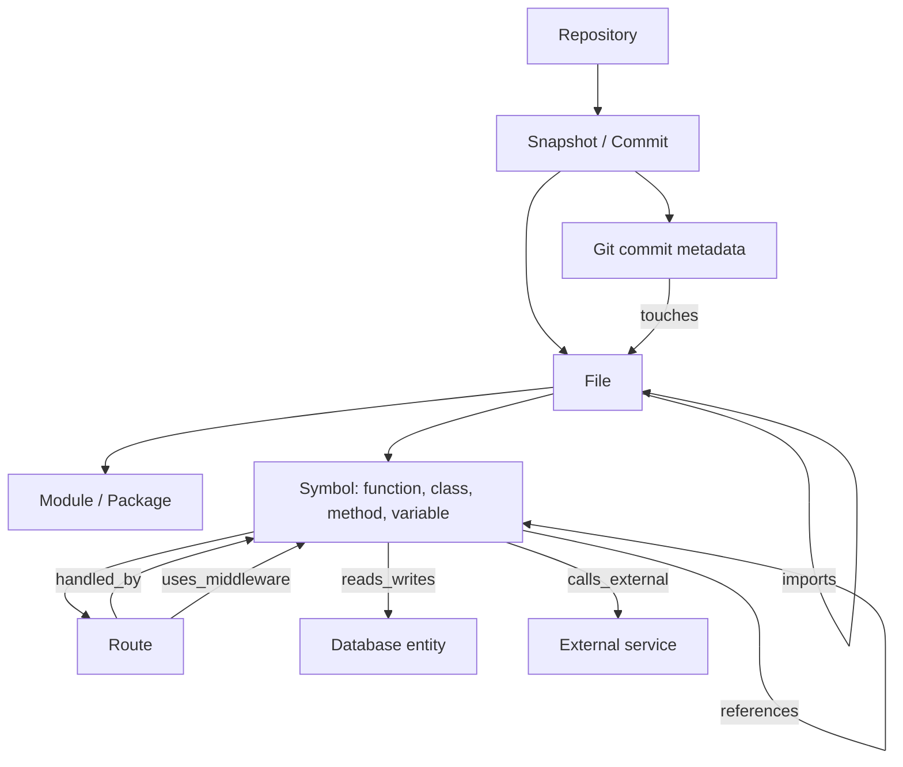

**Three layers of information:**

| Layer | Content | Trust |
| --- | --- | --- |
| **Facts** | Declarations, imports, direct calls, route registrations, commit history | Derived directly from source/Git |
| **Inferences** | Resolved dynamic calls, convention-based roles (e.g. "service"), cross-module data flow | Heuristic, with confidence |
| **Narrative** | LLM summaries and explanations | Generated, always labeled, cached separately |

Consumers: GitFlow (traversal), GitExplain (neighborhood queries), GitTime (diffs between snapshots), search, overview.

---

## 12. Graph Data Model

**Node kinds:** Repository, Snapshot, File, Module, Symbol (function/class/method/variable/type), Route, Middleware, DatabaseEntity, ExternalService, Commit, Author (optional), Dependency (package).

**Edge kinds:** `contains`, `imports`, `calls`, `references`, `extends/implements`, `handled_by`, `uses_middleware`, `reads/writes`, `calls_external`, `depends_on_package`, `touches` (commit→file), `introduced_in`/`removed_in` (for GitTime).

**Required attributes on every node**

- `id` (stable, see below), `kind`, `name`, `qualifiedName`
- `sourceRef`: repo, commit SHA, path, start/end line and column
- `language`, `snapshotId`

**Required attributes on every edge**

- `from`, `to`, `kind`
- `provenance`: `EXTRACTED` | `INFERRED` | `LLM`
- `confidence`: 0.0 to 1.0 (1.0 for direct extraction)
- `evidence`: source location(s) that justify the edge
- `analyzer`: plugin and version that produced it

**Stable node identity (critical for GitTime):** identity is derived from `(repo, language, path-independent qualified name where possible, kind)` plus a path fallback, so the same function across commits maps to the same logical entity. A separate **entity-lineage** table records renames and moves (from Git rename detection + symbol similarity).

**Storage shape (Postgres):** `nodes` and `edges` tables partitioned or indexed by `snapshotId`; JSONB for kind-specific attributes; indexes on (snapshot, kind, qualifiedName), (snapshot, from), (snapshot, to). Traversals use recursive CTEs with depth limits.

---

## 13. Language Parser / Analyzer Abstraction

**Responsibility:** isolate everything language-specific behind one contract so the core never knows about a language.

**A language plugin declares:**

- File detection (extensions, shebangs, config files)
- Parser binding (tree-sitter grammar)
- Extractors for declarations, imports, call sites
- Module/import resolution rules (e.g. tsconfig paths, Python packages)
- Optional precise resolver (TypeScript compiler API / ts-morph for TS; Jedi or pyright-style resolution for Python later)
- A list of **framework adapters**

**A framework adapter declares:**

- Detection (dependencies in manifests, imports)
- Recognizers for entrypoints (routes, handlers), middleware ordering, layer roles, DB access, outbound calls
- Conformance fixtures (see testing)

**Output contract:** plugins emit a **language-neutral fact set** (the same node/edge vocabulary as the RIG). Adding a language means implementing the plugin contract and passing the shared conformance suite.

**MVP:** one TypeScript/JavaScript plugin with an Express adapter, then NestJS/Fastify. **Next:** Python with FastAPI/Flask.

---

## 14. GitFlow Architecture

**Responsibility:** produce an ordered, source-linked execution path for a question or entrypoint.

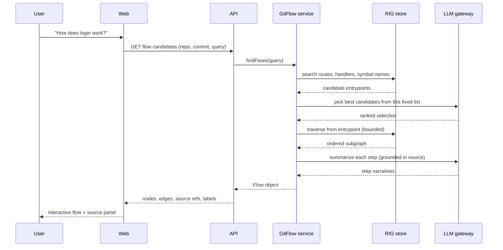

**Flow discovery rules**

1. **Deterministic candidate generation:** from routes/entrypoints and name/path/keyword matching over the RIG.
2. **LLM selects among real candidates** (never invents one).
3. **Bounded traversal** from the entrypoint: follow `uses_middleware` in order, then `handled_by`, then `calls` through controller → service → repository → DB/external, with depth, fan-out, and noise limits (skip logging, utilities, framework internals unless relevant).
4. **Step typing:** route, middleware, controller, service, data access, external call, response.
5. **Branch handling:** show primary path; collapse alternatives (error branches, conditional paths) as expandable.
6. **Output:** a `Flow` object stored and cached by (snapshot, entrypoint, analyzerVersion).

**Every step** links to a node ID and `sourceRef`, plus a provenance badge.

**Default landing:** because GitFlow is the entry point, opening `gitflow.com/{owner}/{repo}` must show something useful without the user typing a question. The precomputed flow index (section 22, `flow-index` job) supplies a ranked list of entrypoints, and the top-ranked flow is shown by default. Asking a question ("How does login work?") refines the selection from the same deterministic candidates.

---

## 15. GitExplain Architecture

**Responsibility:** explain a selected element using graph evidence, not free-form guessing.

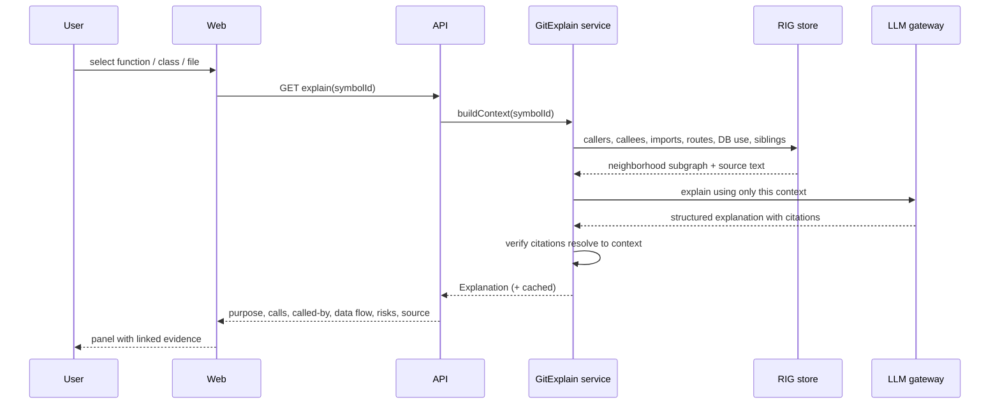

**Context bundle (deterministic):** the element's source, signature, doc comments, direct callers and callees (with confidence), imports used, routes that reach it, data entities touched, external calls, and tests that reference it.

**Sections returned:** what it does, what it calls, what calls it, dependencies, data flow, **potential failure points** (from facts such as unhandled external calls, missing null checks flagged as *inferred*), relevant source.

**Grounding rule:** the structural sections (calls, called-by, dependencies) are rendered **straight from the graph**. Only the prose summary is LLM-generated, and it must cite bundle items that the verifier checks.

---

## 16. GitTime Architecture

**Responsibility:** reconstruct how the architecture changed across commits.

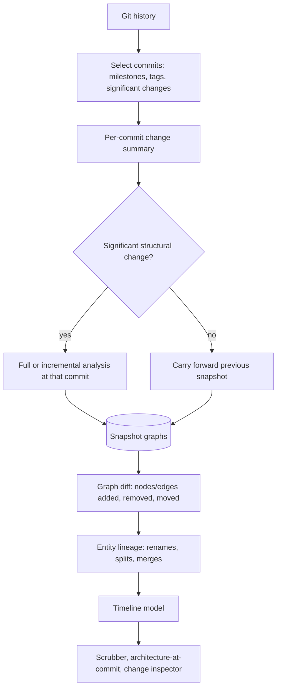

**Key ideas**

- **Do not analyze every commit.** Sample: tags/releases, merge commits to main, commits with large structural diffs, plus time-based buckets. Choose a **budget** of N snapshots per repo.
- **Incremental analysis:** reuse unchanged file results via content hashes; only re-analyze changed files and their dependents.
- **Graph diffs** are first-class stored records (added/removed/changed nodes and edges between two snapshots) so the timeline renders without recomputation.
- **Architecture metrics per snapshot:** module count, dependency count, size per module, coupling indicators; used for growth/split detection.
- **Inspector:** for any architectural change, list responsible commits (from Git `touches` + diff).

**Dependency on foundation:** stable node identity and snapshot-keyed storage (sections 11 to 12). **MVP only reserves the schema; GitTime is built after GitFlow is solid.**

---

## 17. LLM Integration Architecture

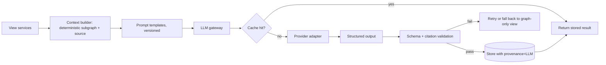

**Principles**

- LLMs **select, summarize, label, and explain**. They never create nodes or edges that appear as facts.
- If an LLM proposes a relationship, it is stored with `provenance = LLM`, low default confidence, and shown distinctly.
- **Structured outputs** with schema validation; citations must reference IDs present in the supplied context.
- **Provider abstraction:** one internal interface; swap models by task (cheap model for step labels, stronger model for explanations).
- **Caching:** by (prompt template version, context hash, model). Same graph + same prompt = reuse.
- **Budgets:** per-repo and per-user token limits; graceful fallback to graph-only output.
- **Prompt-injection defense:** repository content is untrusted data. It is delimited in prompts, the LLM has **no tools with side effects**, and outputs are treated as text only.
- **Embeddings (optional, post-MVP):** only for search/ranking; stored in Postgres with pgvector.

---

## 18. GitHub Integration

| Capability | Mechanism | Phase |
| --- | --- | --- |
| Resolve repo, default branch, SHA | GitHub REST API (unauthenticated or app token) | MVP |
| Fetch source | Tarball/zipball at SHA, or shallow clone | MVP |
| Commit history | Git clone (blobless) or GraphQL/REST commits | GitTime |
| Rate-limit handling | Conditional requests (ETag), token pool for the platform's own GitHub App | MVP |
| User authorization | GitHub OAuth / **GitHub App** (preferred) | Private repos |
| Webhooks | Push events to refresh analyses | Future |
| URL-replacement entry (`github.com` → `gitflow.com`) | Handled entirely by our own routing; no GitHub-side integration or user authorization needed for public repos | **MVP (core)** |
| Optional GitHub-side shortcut | Browser extension or bookmarklet adding an "Open in GitFlow" button | Future convenience |

**Recommendation:** use a **GitHub App** (not plain OAuth) for private access because of fine-grained, per-repository, read-only permissions and short-lived installation tokens.

---

## 19. Public Repository Flow

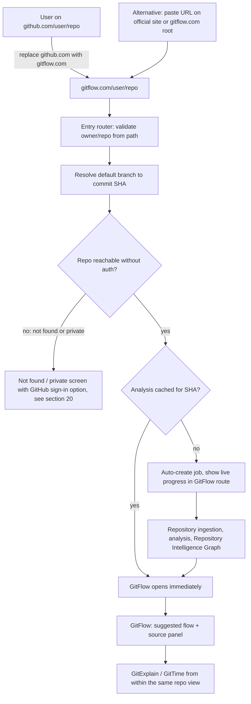

**Core requirement:** `gitflow.com/user/repo` is the primary public experience. The URL alone identifies the repository.

**Friction requirements (public repositories)**

| Requirement | How the architecture meets it |
| --- | --- |
| No signup | Anonymous access to all public-repo analyses and views |
| No manual upload | Source is fetched from GitHub by the worker using the platform's own GitHub App credentials |
| No GitHub authorization | Public repos are read with platform credentials, never the visitor's |
| Fetched and analyzed automatically | Visiting an unseen repo URL enqueues ingestion (idempotent, keyed by repo + SHA + analyzerVersion) |
| URL is sufficient | Repository identity comes from `/{owner}/{repo}` in the path (section 28) |

**First-visit experience:** the route renders immediately and streams stage-level progress (fetching, parsing, resolving, building flows). Results appear progressively: overview as soon as ingestion and the module graph exist, then the suggested flow once the flow index is built. Interactive first-visit jobs are queued ahead of background work (history sampling, re-analysis).

**Anonymous abuse controls:** per-IP rate limits on new-repository analysis, repo size and file-count caps, and shared caching so popular repositories are analyzed once.

**Private vs. public ambiguity:** GitHub reports unreachable and private repositories the same way without authorization, so the screen says "not found or private" and offers GitHub sign-in. That continues into the private flow (section 20), which is unchanged.

**Official website:** remains a secondary path (paste a URL, product pages, docs). Pasting a URL there simply redirects to the same `gitflow.com/{owner}/{repo}` route.

---

## 20. Private Repository Flow

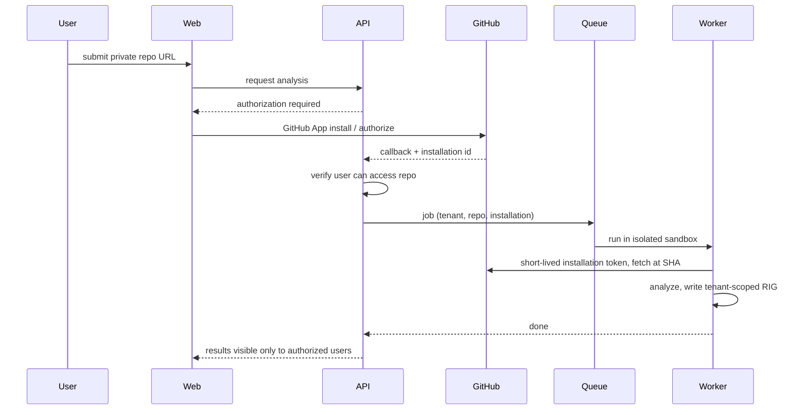

**Rules:** private analyses are **tenant-scoped, never in the shared global cache**, access is re-checked against GitHub on a schedule and on open, and source is encrypted at rest. Not built in MVP, but all tables carry `visibility` and `ownerId` from day one.

---

## 21. API Architecture

**Style:** REST/JSON with OpenAPI generated from Zod schemas, giving a typed client for the frontend and a reliable spec for AI agents. (tRPC is a legitimate alternative if no external API is planned.)

| Group | Purpose |
| --- | --- |
| `/repos` | Submit URL, get repo/snapshot status and overview |
| `/snapshots/{id}/graph` | Subgraph queries: neighbors, search, by-kind |
| `/snapshots/{id}/source` | Source text by path and range |
| `/flows` | Discover candidates, get a flow |
| `/explain` | Explanation for a symbol |
| `/timeline` | Snapshots, diffs, change inspector |
| `/jobs/{id}` | Progress (polling; SSE for streaming) |
| `/auth`, `/github` | Sessions, installation callbacks |

**Conventions:** IDs are opaque and stable; all responses carry `snapshot`, `analyzerVersion`, and per-item `provenance`; pagination on graph queries; hard caps on subgraph size.

---

## 22. Background Jobs / Processing Architecture

**Job types:** `ingest`, `analyze`, `derive` (overview, module graph), `flow-index`, `llm-enrich`, `history-sample`, `history-analyze`, `cleanup`.

**Design:** pg-boss on the same Postgres. Jobs are **idempotent**, keyed by (repo, SHA, analyzerVersion, stage). The worker reports **stage-level progress** to the job record for UI display.

**Concurrency:** worker pool sized by CPU/memory; per-job file-level parallelism inside the analyzer. Jobs have timeouts and memory ceilings.

**Escalation path:** if volume demands, move to Redis/BullMQ, Temporal, or a cloud queue behind the same orchestrator interface.

---

## 23. Caching Strategy

| Layer | Key | Notes |
| --- | --- | --- |
| Snapshot/RIG cache | (repo, SHA, analyzerVersion) | The main cache. Global for public repos. |
| File-level analysis cache | file content hash + analyzer version | Enables incremental reanalysis, key to GitTime |
| Flow cache | (snapshot, entrypoint, flowVersion) | Flows are computed once, reused on share |
| LLM cache | (template version, context hash, model) | Cuts cost, ensures stable shared pages |
| HTTP/CDN | Immutable URLs per SHA | Commit-pinned pages are cacheable forever |
| GitHub API | ETag conditional requests | Saves rate limit |

**Invalidation:** bumping `analyzerVersion` or `flowVersion` invalidates derived data. Branch heads are resolved to SHAs, and a "latest" URL is a pointer to a SHA.

---

## 24. Storage Strategy

| Data | Store | Notes |
| --- | --- | --- |
| Users, repos, jobs, snapshots metadata | PostgreSQL | System of record |
| RIG nodes/edges | PostgreSQL | Indexed per snapshot |
| Source archives and file contents | Object storage (S3-compatible, e.g. Cloudflare R2) | Content-addressed, encrypted for private |
| Large derived artifacts (graph exports, diffs) | Object storage | Referenced from Postgres |
| LLM outputs | PostgreSQL | With provenance and context hash |
| Ephemeral clones | Worker local disk | Deleted after job |

**Retention:** public snapshots retained by popularity/recency; private source deleted on a defined policy or on user request. Graph rows can outlive source only if they contain no source text (design the schema so snippets are fetched from storage, not copied into rows).

---

## 25. Security Architecture

**Core threat:** we process untrusted code and untrusted text.

- **Never execute repository code.** No installs, no build scripts, no tests. Analysis is parse-only.
- **Worker sandboxing:** containers with no outbound network except GitHub and the LLM gateway, read-only root filesystem, CPU/memory/time limits, non-root, ephemeral disk. Stronger isolation (gVisor/Firecracker) for private multi-tenant later.
- **Resource-abuse defenses:** repo size and file-count caps, decompression-bomb checks, parse timeouts, symlink and path-traversal protection on archive extraction.
- **SSRF/URL safety:** only accept `{owner}/{repo}` values that match GitHub's naming rules, whether taken from the `gitflow.com` path or from a pasted `github.com` URL; resolve via the API, never fetch arbitrary hosts.
- **Prompt injection:** treat repo text as data; LLM has no side-effect tools (section 17).
- **Secrets:** tokens in a secrets manager; no tokens in logs; short-lived installation tokens.
- **Rate limiting and abuse controls** on submission endpoints.
- **Dependencies:** lockfile pinning, automated vulnerability scanning.

---

## 26. Authentication / Authorization

- **Public:** anonymous access to public-repo analyses.
- **Accounts:** GitHub sign-in (OAuth) for identity; **GitHub App installation** for repo access.
- **Authorization model:** every graph/source/LLM query is scoped by (`visibility`, `ownerId`/tenant). A single **authorization gate** in the API layer checks access before any data access, and the gate is enforced in the data-access layer (not just in route handlers).
- **Private access check:** verify via GitHub that the user can read the repository, at open time and on a refresh interval.
- **Sessions:** secure, HTTP-only cookies; short-lived access tokens.
- **Tenant isolation:** `tenantId` on all rows; consider Postgres row-level security as a defense-in-depth layer.

---

## 27. Source-Code Privacy Considerations

- Private source is **never** placed in the shared cache, shared LLM cache, or search index.
- **LLM data handling:** choose providers with no-training/zero-retention terms; disclose clearly; allow users to disable LLM features for private repos.
- Minimize what is sent: only the context bundle, not whole repos.
- Encrypt at rest and in transit; per-tenant key scoping in future.
- **Deletion:** a user can remove a repo and all derived data (graph, snapshots, LLM outputs, caches).
- **Logs:** never log source content or tokens; log IDs and sizes only.
- **Share links for private repos:** require authorization; no anonymous "unlisted" links unless explicitly designed later.

---

## 28. URL / Share Architecture

**Core requirement: host replacement.** The primary public entry is the GitHub URL with `github.com` swapped for `gitflow.com`. The path after the host mirrors GitHub's, so the swap works without any other change.

```text
GitHub                  github.com/user/repo
        ↓  replace host
GitFlow                 gitflow.com/user/repo
        ↓
Repository ingestion → Repository Intelligence Graph → GitFlow visualization
```

**Entry URLs (mirror GitHub paths)**

| GitHub URL | GitFlow URL | Result |
| --- | --- | --- |
| `github.com/{owner}/{repo}` | `gitflow.com/{owner}/{repo}` | GitFlow for the default branch (resolved to latest SHA) |
| `github.com/{owner}/{repo}/tree/{ref}` | `gitflow.com/{owner}/{repo}/tree/{ref}` | GitFlow pinned to that ref (resolved to a SHA) |
| `github.com/{owner}/{repo}/blob/{ref}/{path}` | `gitflow.com/{owner}/{repo}/blob/{ref}/{path}` | GitExplain for that file (post-MVP; MVP falls back to the repo's GitFlow view) |

**Native view URLs (all under the same repo path)**

| Target | Pattern |
| --- | --- |
| Pinned repository | `/{owner}/{repo}/tree/{sha}` |
| Flow | `/{owner}/{repo}/tree/{sha}/flow/{entrypoint-slug or flowId}` |
| Explain | `/{owner}/{repo}/blob/{sha}/{path}#{symbol}` |
| History | `/{owner}/{repo}/time` and `/{owner}/{repo}/time/{sha}` |

**Routing rules**

- A path with two segments (`/{owner}/{repo}`) is a repository. Names are validated against GitHub's naming rules and normalized case-insensitively; renamed or transferred repositories resolve to their canonical identity.
- Internal routes are underscore-prefixed (`/_next`, `/_auth`, `/_share`). GitHub names cannot start with an underscore, so internal routes cannot collide with repositories. The API is served from its own hostname (`api.`), not a path prefix.
- The host root shows a minimal paste-URL box that redirects into `/{owner}/{repo}`. The official website's product and documentation pages live on the official site's hostname.
- The **Share** action always emits the commit-pinned form, so shared links never drift even if the default branch moves. The address bar keeps whatever the user typed.
- Public URLs require no authentication. The same URL shape is used for private repositories, which resolve to the authorization flow in section 20 when the visitor lacks access.

**Sharing**

- All UI state (selected node, zoom, step) is encoded in the URL so any view is shareable.
- Server-rendered metadata (title, description, OpenGraph image) for link previews; a generated flow image is a strong viral asset.
- Short links for flows via a small `shares` table.
- `gitflow.com` and the official website are hostnames served by the **same app and infrastructure**: no separate codebase, pipeline, or deployment per mode.

---

## 29. Observability / Logging

- **Structured logs** (JSON) with `requestId`, `jobId`, `repo`, `sha`, `stage`.
- **Metrics:** job duration by stage, queue depth, cache hit rate, parse failures per language, graph size, LLM latency/cost/tokens, API p95.
- **Tracing:** OpenTelemetry across API → queue → worker.
- **Error tracking:** Sentry or equivalent.
- **Analysis quality telemetry:** unresolved-call ratio, percent of routes with resolved handlers, flows produced per repo. These measure *correctness*, which is the product's core.

---

## 30. Error Handling

- **Partial results beat failure.** If a file fails to parse, record a `file_error` fact, continue, and surface "analysis incomplete for N files."
- **Typed errors** with user-safe messages: repo not found, too large, unsupported language, rate limited, private (needs auth), analysis failed.
- **Stage isolation:** failures are attributed to a stage and are retryable from that stage.
- **LLM failure fallback:** show the graph-only view with no narrative.
- **Graceful degradation:** unsupported framework → show module/import graph and GitExplain, but no flows, with a clear message.

---

## 31. Performance Considerations

- Parse in parallel per file; use tree-sitter's speed; skip vendored/generated/minified files.
- **Precompute** flow indexes and overview during analysis so interactive requests are cheap graph lookups.
- Bound traversals (depth, fan-out) and subgraph response sizes.
- Frontend: virtualize large lists, render only visible nodes, collapse clusters by module, lazy-load source ranges.
- **Targets (MVP, guidance):** typical small/medium repo analyzed in under a few minutes; cached repo opens in under 1 second; flow render under 2 seconds after request.

---

## 32. Scalability Considerations

The architecture scales along clear seams without redesign:

1. **Workers:** horizontally add worker instances (stateless, queue-driven).
2. **Database:** read replicas; partition `nodes`/`edges` by snapshot; archive cold snapshots to object storage.
3. **Graph engine:** if traversals outgrow Postgres, project the RIG into a dedicated graph store (see section 46) while Postgres remains the system of record.
4. **Queue:** swap implementation behind the orchestrator interface.
5. **Hot repos:** global cache plus CDN for immutable commit-pinned pages.
6. **LLM cost:** caching, tiered models, per-user limits.

---

## 33. Deployment Architecture

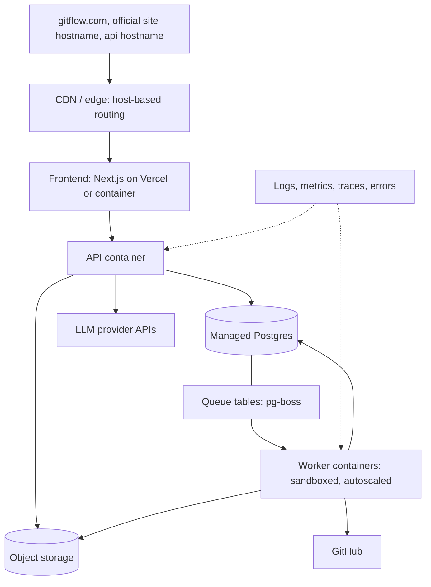

**MVP hosting suggestion:** frontend on Vercel (or same container), API + worker on Fly.io / Railway / Render containers, managed Postgres (Neon / Supabase / RDS), Cloudflare R2. Environments: `dev` (local), `staging`, `prod`. Infrastructure as code (Terraform or provider config) once more than one environment exists.

**Domains and routing:** `gitflow.com` (repository routes, GitFlow-first), the official site hostname (marketing, product pages, docs), and the API hostname all point at the same deployment. Edge routing is by host and path: `gitflow.com/{owner}/{repo}...` goes to the repository route (SSR, with anonymous responses for commit-pinned pages cacheable at the edge), the official hostname goes to the marketing routes, and the API hostname goes to the API service. There is one frontend deployment, one API, and one worker pool.

---

## 34. Local Development Architecture

- **One command to run everything:** Docker Compose for Postgres and object storage (MinIO); API, worker, and web run via the monorepo's dev scripts.
- **Fixtures:** a set of small **pinned sample repositories** (e.g., a minimal Express shop, a NestJS app) checked in or fetched at fixed SHAs, so analysis is testable offline.
- **LLM in dev:** a mock/record-replay provider so tests are deterministic and free.
- **Seed script** to analyze a fixture and populate a RIG for frontend work.
- `.env.example`, typed config validation at startup, and a short `AGENTS.md` / contributor guide describing module boundaries for AI agents.

---

## 35. Testing Strategy

| Level | What it verifies |
| --- | --- |
| **Unit** | Extractors, resolvers, graph builders |
| **Golden/snapshot tests** | For each fixture repo, the produced graph (nodes, edges, flows) matches an approved expected output. *This is the most important test type for correctness.* |
| **Adapter conformance suite** | Every language/framework plugin passes the same contract tests |
| **Integration** | Ingest → analyze → store → query on fixtures |
| **API contract tests** | OpenAPI schema compliance |
| **LLM tests** | Citation validity and schema validation with recorded responses; small eval set for explanation quality |
| **E2E (Playwright)** | Open `gitflow.com/{owner}/{repo}` → see progress → view flow → click node → source opens at the right lines; URL routing and reserved-path tests |
| **Security tests** | Archive path traversal, oversized repos, prompt-injection fixtures, authorization tests across tenants |
| **Regression corpus** | A growing list of real-world repos with expected flow counts and unresolved-call thresholds |

---

## 36. CI/CD Strategy

- **CI (GitHub Actions):** typecheck, lint, unit + golden tests, build, container build, schema/OpenAPI diff check, dependency audit. Run the fixture-based integration suite on every PR.
- **Quality gate:** analyzer changes must not regress the golden outputs without an explicit approved update.
- **CD:** preview deployments for the frontend per PR; auto-deploy `main` to staging; manual promote to prod.
- **Migrations:** versioned SQL migrations (Drizzle/Prisma/Atlas) run as a deploy step; backward-compatible changes preferred.
- **Analyzer versioning:** releasing a new analyzer version triggers lazy re-analysis (on next access) rather than a mass backfill.

---

## 37. Repository Processing Lifecycle

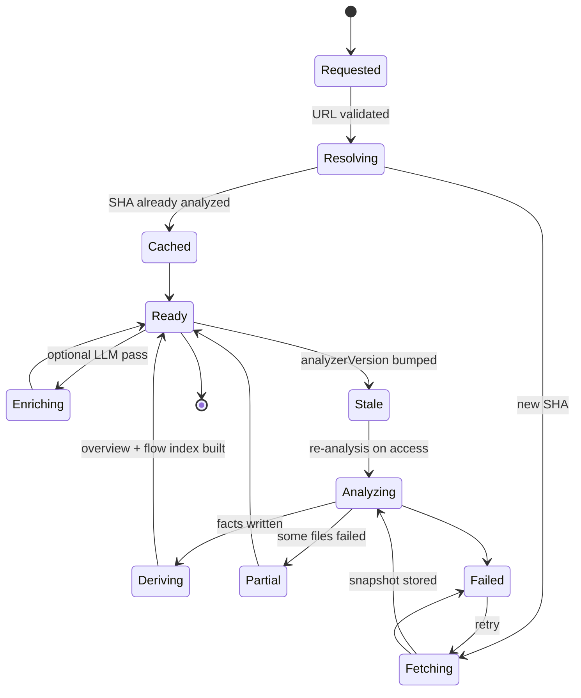

---

## 38. Failure / Retry Strategy

| Failure | Handling |
| --- | --- |
| GitHub rate limit / transient network | Exponential backoff with jitter, honor `Retry-After` |
| Repo too large / unsupported | Fail fast with a clear user-facing reason, no retry |
| Worker crash / timeout | Job returns to queue; idempotent stage keys prevent duplicate data |
| Parse error in a file | Record, continue, mark snapshot `Partial` |
| LLM error / invalid output | Retry once with a repair prompt, then fall back to graph-only |
| Poison jobs | Max attempts, then dead-letter queue and alert |
| Partial writes | Stage writes are transactional per snapshot; a snapshot is only `Ready` after validation |

---

## 39. Extensibility Strategy

- **New language:** implement the language plugin contract, pass the conformance suite, register it.
- **New framework:** add an adapter to an existing language plugin.
- **New view/mode:** a new view service reading the RIG, with no change to ingestion or analysis.
- **New edge/node kinds:** additive schema changes; consumers ignore unknown kinds.
- **New LLM provider:** implement the provider adapter.
- **New data source (GitLab, Bitbucket):** implement a source-provider adapter behind the ingestion interface.
- **Versioned everything:** graph schema, analyzer, flow format, prompts.

---

## 40. Recommended Technology Stack

| Layer | Recommendation | Why |
| --- | --- | --- |
| Language | **TypeScript** everywhere | One language, shared types, excellent AI-agent support |
| Monorepo | pnpm workspaces + Turborepo | Simple, fast |
| Frontend | Next.js, React, Tailwind, shadcn/ui | Mature, SSR for share pages |
| Graph UI | React Flow + elkjs; Cytoscape/Sigma at scale | Fit for flows, upgradeable |
| Code view | Monaco or CodeMirror 6 + Shiki | Line-range linking |
| API | Fastify or Hono + Zod + OpenAPI | Typed, light |
| DB | PostgreSQL (+ pgvector later) | One store for most needs |
| Queue | pg-boss | No extra infrastructure |
| Parsing | tree-sitter; TypeScript compiler API/ts-morph for TS precision | Deterministic, multi-language |
| Git | `git` CLI via worker; isomorphic-git/libgit2 optional | CLI is the most reliable |
| Object storage | S3-compatible (R2 / S3 / MinIO locally) | Portable |
| LLM | Provider-agnostic gateway; strong model for explanations, cheaper for labels | Cost control |
| Auth | GitHub App + OAuth, session cookies | Aligns with private repo needs |
| Observability | OpenTelemetry, Sentry, Grafana/Axiom | Standard |
| CI | GitHub Actions | Native |

---

## 41. Technology Alternatives and Tradeoffs

| Choice | Alternative | Tradeoff |
| --- | --- | --- |
| TypeScript worker | Python worker | Python has richer analysis libraries (e.g. Jedi), but splits the stack. Reconsider when Python analysis depth matters. |
| Postgres as graph store | Neo4j / Memgraph / Kùzu | Graph DBs offer nicer traversal syntax, but add operations and sync complexity. Defer. |
| pg-boss | BullMQ (Redis), Temporal, SQS | Heavier infra for MVP; Temporal helps long, multi-stage GitTime pipelines later. |
| tree-sitter | LSP servers, SCIP/LSIF indexers, Semgrep | **SCIP indexers** give precise cross-reference data for some languages and are worth evaluating as an *input* to the RIG. Tree-sitter remains the uniform baseline. |
| REST + OpenAPI | tRPC, GraphQL | tRPC is faster internally; REST is better for public/agent use; GraphQL fits graph queries but costs complexity. |
| Next.js | Vite SPA + separate SSR for share pages | SPA is simpler, but weaker link previews/SEO. |
| React Flow | Cytoscape, Sigma, D3, AntV G6 | React Flow is easiest for step flows; others handle thousands of nodes better. |
| Vercel + Fly | AWS/GCP | Cloud-native control and sandboxing options, but more setup. |
| Managed LLM API | Self-hosted models | Self-hosting only if private-code requirements demand it. |

---

## 42. Suggested Project Directory Structure

```
repo-root/
├─ apps/
│  ├─ web/                 # Next.js frontend: gitflow.com repo routes (all modes) + official site, host-routed
│  ├─ api/                 # HTTP API
│  └─ worker/              # Job runner (ingest, analyze, history)
├─ packages/
│  ├─ core/                # Domain types, graph schema, contracts, IDs
│  ├─ ingest/              # GitHub fetch, snapshot, manifest
│  ├─ analyze/             # Pipeline orchestration, passes
│  ├─ lang-typescript/     # Language plugin + framework adapters
│  ├─ lang-python/         # (later)
│  ├─ graph/               # RIG storage, queries, traversals
│  ├─ gitflow/             # Flow discovery and assembly
│  ├─ gitexplain/          # Context builder, explanation assembly
│  ├─ gittime/             # Sampling, snapshot diff, lineage
│  ├─ llm/                 # Gateway, prompts, validators, cache
│  ├─ github/              # API client, App auth
│  └─ ui/                  # Shared React components (graph, source panel)
├─ fixtures/               # Pinned sample repos and golden outputs
├─ infra/                  # Docker, deploy config, migrations
├─ docs/                   # This document, ADRs, contributor guide
└─ AGENTS.md               # Rules and module boundaries for AI agents
```

**Dependency rule:** `core` depends on nothing; view packages (`gitflow`, `gitexplain`, `gittime`) depend on `graph` and `llm` but **never on each other** and never on `analyze`.

---

## 43. Important Interfaces / Contracts Between Components

| Contract | Between | Contents (conceptual) |
| --- | --- | --- |
| **SourceProvider** | Ingestion ↔ GitHub (or other hosts) | Resolve ref to SHA, fetch archive, list history |
| **RepoIdentity** | Entry router → API | Owner, repo, optional ref, resolved SHA, visibility (public / private-or-missing), requested view |
| **Snapshot / Manifest** | Ingestion → Analysis | Repo, SHA, file list with hashes, languages, size, source location in storage |
| **LanguagePlugin** | Analysis ↔ language modules | Detect, parse, extract facts, resolve imports, list adapters |
| **FrameworkAdapter** | Plugin ↔ adapters | Detect framework, emit route/middleware/layer/DB/external facts |
| **FactSet** | Plugins → Graph builder | Nodes and edges in RIG vocabulary, with provenance and evidence |
| **GraphStore** | Views ↔ storage | getNode, neighbors, traverse(bounded), search, diff(snapshotA, snapshotB) |
| **SourceRef** | Everywhere | repo, commit SHA, path, start/end positions |
| **Flow** | GitFlow → UI | Ordered steps (node ID, step type, sourceRef, provenance, narrative, branches) |
| **Explanation** | GitExplain → UI | Structural sections from graph + narrative with citations |
| **TimelineModel** | GitTime → UI | Snapshots, metrics, diffs, lineage, responsible commits |
| **LLMGateway** | Views ↔ providers | Task type, context bundle, output schema → validated result + usage |
| **JobSpec** | API ↔ Worker | Type, idempotency key, tenant, repo, SHA, analyzerVersion |
| **AuthorizationGate** | API ↔ data layer | (principal, resource) → allow/deny |

**Rule:** contracts live in `packages/core`, are schema-validated (Zod), and are the only thing AI agents may change with human review.

---

## 44. MVP Architecture

**Build:**

- Public repos only, entered via **`gitflow.com/{owner}/{repo}`** (host replacement) with auto-ingest on first visit and no signup, upload, or GitHub authorization; a minimal paste-URL box and one-page official site as the secondary path; resolve to SHA; fetch tarball.
- **One language plugin:** TypeScript/JavaScript, with **Express** adapter (NestJS/Fastify next).
- Passes: parse, extract, resolve, route/middleware/handler detection, DB/external-call detection (a few common libraries).
- RIG in Postgres with full provenance/confidence fields.
- **GitFlow:** entrypoint list (routes), flow assembly, bounded traversal, step typing, source-linked graph UI.
- **GitExplain (thin):** click a node → structural neighborhood from the graph (+ optional LLM summary).
- LLM gateway with caching, used for candidate selection and short step/summary text.
- pg-boss worker, single environment, basic observability, golden-test suite on 3 to 5 fixtures.
- Commit-pinned URLs and shareable flow links.

**Reserve (schema/interfaces only, no implementation):** GitTime tables and stable IDs, private-repo fields (`ownerId`, `visibility`), analyzer versioning, authorization gate (public-only policy).

**Explicitly not in MVP:** private repos, GitHub extension, GitTime UI, Python, embeddings, multi-tenant sandboxing, webhooks.

---

## 45. Post-MVP Architecture

1. **GitExplain full:** file/class-level explanations, failure-point detection, data-flow views, in-code navigation.
2. **GitTime:** blobless history clone, snapshot sampling, incremental analysis, graph diffs, entity lineage, timeline UI.
3. **Second language (Python)** and more TS frameworks.
4. **Private repos:** GitHub App, tenant isolation, hardened sandbox, encrypted storage.
5. **GitHub-side shortcuts:** browser extension or bookmarklet ("Open in GitFlow" button) layered on top of the core URL-replacement entry; GitHub `blob` / `tree` path mirroring into GitExplain and pinned views.
6. **Search and embeddings** (pgvector) for natural-language flow discovery.
7. **Webhooks** for freshness.
8. **Precision upgrades:** SCIP/LSIF ingestion, type-aware resolution.

---

## 46. Migration / Evolution Strategy

- **Schema evolution:** additive changes first; version the graph schema; keep readers tolerant of unknown kinds.
- **Analyzer evolution:** `analyzerVersion` on every fact; re-analyze lazily; keep golden tests as the safety net.
- **Postgres → graph engine:** if needed, add a *projection* of the RIG into a graph DB, with Postgres still the source of truth. Views switch their `GraphStore` implementation, so only `packages/graph` changes.
- **Queue evolution:** change implementation behind the orchestrator interface.
- **Monolith → services:** the worker already runs separately; if needed, split the API into read-path and write-path services along existing package boundaries.
- **Modes to separate domains:** routing/aliasing only; infrastructure stays shared.

---

## 47. Major Technical Risks

| Risk | Impact | Mitigation |
| --- | --- | --- |
| **Call resolution accuracy** in dynamic languages (DI, callbacks, dynamic dispatch) | Wrong or missing flow steps | Confidence scoring, multiple candidates, show uncertainty, prefer framework adapters for known patterns |
| **Framework diversity** | Flows work only on supported frameworks | Start narrow, adapter conformance suite, graceful degradation |
| **Noisy flows** (too many steps, utility calls) | Unreadable output | Step typing, noise filters, collapse rules, user-adjustable depth |
| **LLM hallucination** | Loss of trust | Grounding, citation verification, provenance labels |
| **Large repos / monorepos** | Slow or failed analysis | Limits, scoped analysis (sub-directory), incremental caching |
| **GitTime cost and identity tracking** | Expensive; unstable entities | Sampling budget, incremental analysis, lineage table, delay to post-MVP |
| **Untrusted code processing** | Security incidents | Parse-only, sandbox, strict limits |
| **GitHub rate limits** | Throttled ingestion | App tokens, caching, tarballs instead of per-file API |
| **Zero-friction anonymous entry** (no signup, auto-analysis on visit) | Abuse and cost spikes; slow first visit with no landing page to hide behind | Per-IP limits, size caps, shared cache, prioritized interactive jobs, progressive results with live progress |
| **LLM cost** | Margin pressure | Caching, small models for labels, quotas |
| **AI-agent drift** (inconsistent code) | Maintainability loss | Strict contracts, golden tests, `AGENTS.md`, small packages |

---

## 48. Architectural Decisions That Should NOT Be Changed Casually

1. **One shared RIG; no per-mode analysis.**
2. **Deterministic analysis first; LLMs never create facts.**
3. **Provenance + confidence on every edge; evidence on every node.**
4. **Snapshots keyed by commit SHA; URLs commit-pinned.**
5. **Stable node identity and lineage design** (retrofitting is very costly).
6. **Language-neutral FactSet and plugin contract.**
7. **Never execute repository code.**
8. **Authorization gate in the data layer; tenant fields from day one.**
9. **Private data never enters shared caches.**
10. **View packages depend on the graph, not on each other or on the analyzer.**
11. **Versioned analyzer, flow format, and prompts.**
12. **GitFlow-first public entry:** `gitflow.com/{owner}/{repo}` lands directly in GitFlow, and owner/repo in the URL path is sufficient to identify a public repository.
13. **No gating of the public path:** no signup, upload, or GitHub authorization for public repositories. Authorization is only for private ones.
14. **One app, many hostnames:** `gitflow.com`, the official site, and the API share one codebase and infrastructure. No per-mode codebases or analysis pipelines.

---

## 49. Open Questions

1. Which TypeScript frameworks do target users' repos use most (Express vs NestJS vs Next.js API routes)? This decides adapter priority.
2. Is the first audience backend developers exploring OSS, or engineers onboarding to their own codebases? This affects private-repo timing.
3. What are acceptable analysis time and repo-size limits for the free public tier?
4. Do we need precise type-aware resolution early, or is tree-sitter + heuristics enough for the milestone?
5. Pricing and quotas: who pays for LLM usage on public repos?
6. Should flow discovery be primarily natural-language ("how does login work?") or entrypoint-browsing first?
7. Is a GitHub-side shortcut (extension or bookmarklet) needed at launch, given that host replacement already covers the core entry?
8. Retention policy for public snapshots and for private source.
9. How should monorepos be scoped (per package, per service)?
10. Is a public API or embeddable flow widget planned (affects API stability promises)?
11. Domain and naming: is `gitflow.com` secured, and how do we handle search and naming overlap with the well-known "Gitflow" branching workflow and with GitHub's own trademark guidelines?
12. What anonymous usage limits (analyses per IP per day, max repo size) keep the zero-signup public path sustainable?

---

## 50. Recommended Implementation Order

1. **Foundation:** monorepo, `core` contracts, Postgres schema (nodes/edges with provenance, SHA-keyed snapshots), local dev with Docker Compose, CI.
2. **Fixtures first:** 3 to 5 small pinned Express/TS repos with hand-written expected flows (golden outputs).
3. **Ingestion:** `/{owner}/{repo}` route → RepoIdentity → SHA → tarball → manifest → stored snapshot (auto-triggered on first visit).
4. **TS/JS parsing + extraction:** declarations, imports, calls; golden tests on the module/import graph.
5. **Resolution + Express adapter:** routes, middleware, handlers; **first end-to-end flow (milestone prototype)** on a fixture.
6. **Graph store + queries:** neighbors, bounded traversal, search.
7. **GitFlow service + minimal UI:** `gitflow.com/{owner}/{repo}` route with progress → suggested flow → flow graph → source panel with line-range links.
8. **Run on real repositories;** measure unresolved-call ratio; iterate adapters and noise filters until the milestone is reliable.
9. **LLM gateway:** candidate selection, step labels, summaries, with grounding and caching.
10. **Thin GitExplain:** node neighborhood panel.
11. **Share URLs, host-based routing and `gitflow.com` domain setup, minimal official site, OG images, progress UX, anonymous rate limits, observability.**
12. **Public launch of MVP.**
13. **Post-MVP in order:** full GitExplain → GitTime → Python → private repos (GitHub App + sandbox hardening) → GitHub-side shortcuts.

---

# Appendix A: Concrete End-to-End Example

**User action:** while viewing `https://github.com/example/shop` (an Express + TypeScript app with `POST /login`), the user replaces `github.com` with `gitflow.com` and opens `https://gitflow.com/example/shop`. No signup, upload, or GitHub authorization is involved.

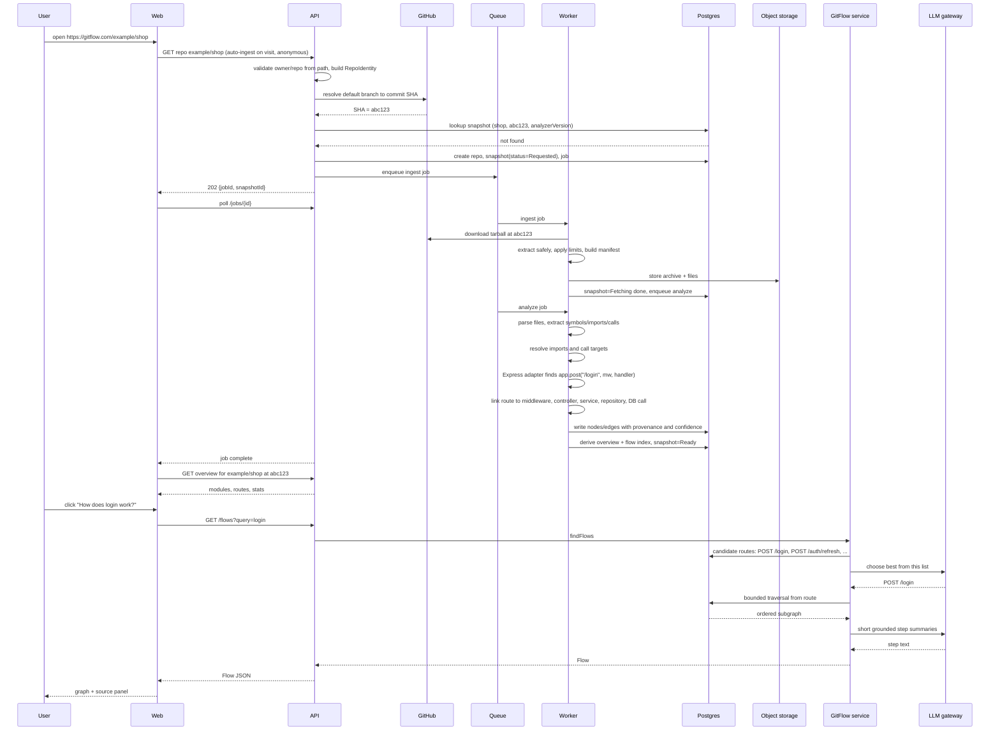

**What the user sees:**

| Step | Node | Source link | Provenance |
| --- | --- | --- | --- |
| 1 | `POST /login` route | `src/routes/auth.ts:12-14` | Extracted |
| 2 | `rateLimit` middleware | `src/middleware/rateLimit.ts:5-30` | Extracted |
| 3 | `validateBody` middleware | `src/middleware/validate.ts:8-22` | Extracted |
| 4 | `AuthController.login` | `src/controllers/auth.controller.ts:20-48` | Extracted |
| 5 | `AuthService.authenticate` | `src/services/auth.service.ts:15-60` | Extracted |
| 6 | `UserRepository.findByEmail` | `src/repositories/user.repo.ts:10-24` | Extracted |
| 7 | `users` table query | same location | Extracted |
| 8 | `TokenService.sign` | `src/services/token.service.ts:7-25` | Inferred (resolved via DI, confidence 0.8) |
| 9 | Response (200 + token) | `src/controllers/auth.controller.ts:44-48` | Extracted |

Clicking any step opens the exact lines at commit `abc123`. The landing view already preselects the top-ranked flow from the precomputed flow index, so asking "How does login work?" refines the choice rather than being required. The Share action produces the pinned URL, for example `https://gitflow.com/example/shop/tree/abc123/flow/post-login`, which reproduces the same view for anyone, and the second visitor gets it instantly from cache. (Files and lines above are illustrative.)

---

# Appendix B: Why This Reaches the First Milestone Quickly

The milestone requires only: ingestion, one language plugin, one framework adapter, a Postgres-backed graph, bounded traversal, and a source-linked graph UI. Everything GitExplain and GitTime need (stable IDs, provenance, snapshots by SHA, content-hash caches) is in the *schema and contracts* from day one, so those modes are additions on top of the same platform, not rewrites.

---

# Appendix C: Changes Made (v1.0 → v1.1)

**Sections modified**

| Section | Change |
| --- | --- |
| Header | Status bumped to v1.1 |
| 1. Executive Summary | Added the primary public entry requirement paragraph and a "Public entry" table row |
| 2. Product Scope | Rewrote scope bullets around `gitflow.com/user/repo`; added minimal-friction requirement, official-site role, and a product positioning table |
| 3. Architectural Goals | Added goal 9 (zero-friction public entry) |
| 5. High-level System Architecture | Entry nodes in the overall diagram changed; added the primary journey diagram; noted GitFlow as default view |
| 6. Major Components | Updated Web app and GitFlow rows; added Entry router row |
| 7. Frontend Architecture | Host-routed structure; MVP UI updated |
| 8. Backend Architecture | Added auto-analysis-on-first-visit paragraph |
| 14. GitFlow Architecture | Added default landing behavior |
| 18. GitHub Integration | URL-replacement entry added as MVP core; extension reframed as future shortcut |
| 19. Public Repository Flow | Rewritten: new flow, friction requirements table, first-visit experience, abuse controls, private/public ambiguity handling |
| 25. Security Architecture | SSRF line now covers path-derived `{owner}/{repo}` |
| 28. URL / Share Architecture | Rewritten around host replacement, GitHub-mirrored paths, routing rules, and shared hostnames |
| 33. Deployment Architecture | Diagram entry nodes changed; added domains and routing paragraph |
| 35. Testing Strategy | E2E row updated for the new entry and routing tests |
| 42. Directory Structure | `apps/web` comment updated |
| 43. Interfaces / Contracts | Added RepoIdentity |
| 44. MVP Architecture | Entry bullet updated |
| 45. Post-MVP Architecture | Item 5 reframed as GitHub-side shortcuts; removed dedicated-domain alias from item 7 |
| 47. Major Technical Risks | Added zero-friction anonymous entry risk |
| 48. Decisions Not to Change | Added decisions 12 to 14 |
| 49. Open Questions | Updated question 7; added questions 11 and 12 |
| 50. Implementation Order | Steps 3, 7, 11, and the post-MVP ordering updated |
| Appendix A | User action, sequence diagram opening steps and overview call, and closing paragraph updated |

**Diagrams modified or added**

1. Section 5, overall system diagram (modified)
2. Section 5, primary public journey diagram (added)
3. Section 19, public repository flow (replaced)
4. Section 33, deployment diagram (modified)
5. Appendix A, end-to-end sequence diagram (modified)

**Unchanged:** section 20 (private repositories), the Repository Intelligence Graph and data model, analysis pipeline, language plugin architecture, GitExplain, GitTime, LLM architecture, technology recommendations, security architecture (apart from the one SSRF line), and scalability architecture.

### Phase 3 implementation note

The first RIG foundation is implemented as the independent `packages/analyzer` workspace package. It parses TypeScript, TSX, JavaScript, and JSX using the TypeScript syntax tree, then emits versioned snapshot, file, and symbol nodes plus conservative containment, declaration, import, export, call, extends, and implements edges. Every record carries a stable SHA-256 identifier and one-based source evidence. Relative imports use only supported extensions and `index` conventions; unresolved imports and calls remain explicit unresolved edges with reasons. Syntax diagnostics produce partial analysis rather than discarding valid regions.

Persistence is provided by `analysis_runs`, `graph_nodes`, and `graph_edges` in the database package. Graph replacement is performed in one transaction, keyed by immutable snapshot, analyzer version, and schema version, so retries cannot mix commits or leave a successful status with incomplete records. The bounded API surface is `GET /snapshots/:id/graph?limit=...`. Full worker scheduling and richer semantic resolution remain subsequent increments; repository code is never executed.