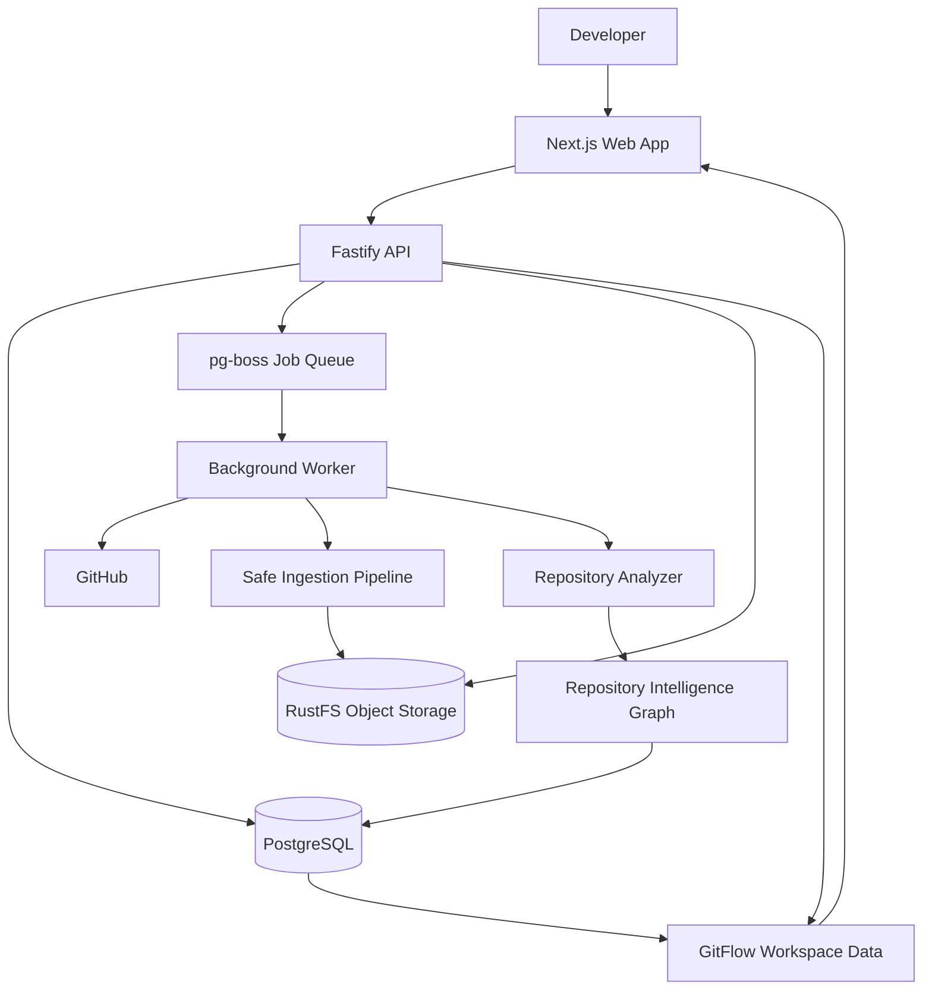

# GitHow
# GitHow

### Understand how a codebase actually works.

GitHow is a developer tool that turns a GitHub repository into a source-backed map of its code structure and relationships.

Instead of jumping between files, searching for function names, and manually tracing imports, GitHow analyzes a repository, builds a **Repository Intelligence Graph (RIG)**, and provides a workspace for exploring files, symbols, relationships, and source code.

**Analyze once. Explore the codebase through its relationships.**

> GitFlow is the first experience being built on top of the shared intelligence graph. GitExplain and GitTime are planned extensions of the same foundation.

---

## The Problem

Understanding an unfamiliar codebase is expensive.

Developers frequently need to answer questions such as:

- Where does a particular function live?
- Which modules depend on this file?
- What does this function call?
- Where is a class implemented or extended?
- How are two seemingly unrelated parts of the application connected?
- Which source code supports a particular relationship?

Traditional code navigation helps locate symbols, but understanding how the pieces fit together often requires substantial manual investigation.

GitHow aims to make that investigation faster by extracting code relationships and connecting them directly to their source evidence.

## What GitHow Does

GitHow processes a repository at a specific Git commit and builds a reusable representation of its structure.

<pre>
GitHub Repository
       |
       v
Resolve Immutable Commit SHA
       |
       v
Download and Validate Repository Archive
       |
       v
Create File Manifest and Snapshot
       |
       v
Parse Source Code and Extract Relationships
       |
       v
Build Repository Intelligence Graph
       |
       v
Persist Graph and Analysis Results
       |
       v
Explore Files, Symbols, Relationships and Source
</pre>

The graph is the shared foundation for GitHow's different product experiences. Each experience can query the same analyzed snapshot instead of independently reprocessing the repository.

## Product Experiences

### GitFlow — Explore code relationships

GitFlow is the first product experience.

It provides a workspace for exploring a repository's file structure, graph nodes, relationships, and source code. The goal is to help developers navigate from a symbol to its connected code and understand how the repository is organized.

Planned capabilities include deeper relationship traversal, richer graph visualization, and application-level execution-flow discovery.

### GitExplain — Understand individual components

Planned.

GitExplain will help developers understand a function, class, module, or other symbol in the context of its surrounding code. Explanations should be grounded in actual source and graph evidence rather than unsupported model-generated claims.

### GitTime — Understand how code evolves

Planned.

GitTime will use Git history and snapshot comparisons to explore how a repository's structure and relationships change over time.

These experiences are intended to share the same underlying intelligence graph.

---

## Current Capabilities

The current implementation provides the foundation for repository ingestion, static analysis, graph persistence, and code exploration.

- **GitHub repository ingestion:** Resolve a repository reference to an immutable commit SHA.
- **Immutable snapshots:** Associate analysis results with a specific repository commit.
- **Safe archive processing:** Validate repository archives and manifests before analyzing supported source files.
- **TypeScript and JavaScript analysis:** Parse `.ts`, `.tsx`, `.js`, and `.jsx` files using the TypeScript compiler AST.
- **Symbol extraction:** Identify supported functions, classes, interfaces, methods, constructors, and other declarations.
- **Relationship extraction:** Record supported imports, exports, declarations, calls, inheritance, and implementation relationships.
- **Repository Intelligence Graph:** Represent extracted facts as typed nodes and edges with stable identifiers and source evidence.
- **Conservative resolution:** Preserve unresolved relationships rather than guessing their targets.
- **Durable background processing:** Run ingestion and analysis through separate worker jobs.
- **Persistent results:** Store snapshots, analysis status, graph nodes, and graph edges in PostgreSQL.
- **Object storage:** Store repository archives and manifests using RustFS, an S3-compatible storage service.
- **Analysis status:** Track progress, diagnostics, completion, and failures.
- **GitFlow workspace:** Explore repository files, graph data, and source code through the web application.
- **Idempotent processing:** Reuse eligible snapshots and prevent duplicate analysis work from corrupting graph state.

The exact completeness of individual UI interactions and advanced graph-navigation features should be judged against the current implementation and tests.

## Architecture

GitHow uses a TypeScript monorepo organized around a modular backend and a separate background worker.



### Technology Stack

| Layer | Technology |
|---|---|
| Language | TypeScript |
| Frontend | Next.js, React |
| API | Fastify |
| Database | PostgreSQL |
| Database access | Drizzle ORM |
| Background jobs | pg-boss |
| Object storage | RustFS, S3-compatible API |
| Monorepo | pnpm workspaces and Turborepo |
| Source analysis | TypeScript compiler AST |
| Validation | Existing typed contracts and validation libraries |
| Testing | Vitest and the repository's existing test tooling |

The project favors proven libraries for commodity infrastructure while keeping the core intelligence logic under GitHow's control.

Libraries handle tasks such as database access, job scheduling, and syntax-tree construction. GitHow owns its graph model, deterministic identifiers, source provenance, relationship-resolution policies, and exploration logic.

### Repository Structure

The monorepo contains applications and shared packages.

```text
.
├── apps/
│   ├── web/             # Next.js frontend
│   ├── api/             # Fastify HTTP API
│   └── worker/          # Ingestion and analysis jobs
├── packages/
│   ├── analyzer/        # Source extraction and RIG construction
│   ├── core/            # Shared domain types and contracts
│   ├── db/              # PostgreSQL schema, migrations and queries
│   ├── github/          # GitHub integration
│   ├── ingest/          # Archive handling and manifest generation
│   └── config/          # Shared configuration
├── docs/                # Project documentation
├── AGENTS.md            # Engineering and coding-agent instructions
├── docker-compose.yml   # Local infrastructure configuration
├── pnpm-workspace.yaml
└── pnpm-lock.yaml
```

This is a conceptual overview. Consult the actual workspace for the current package inventory.

---

## Getting Started

### Prerequisites

Install the following before starting:

- Node.js version compatible with the repository's `engines` configuration.
- pnpm version specified by the project's `packageManager` field.
- Docker Desktop or another compatible Docker Engine and Compose installation.
- Git.

You will also need network access to retrieve public GitHub repositories.

### 1. Clone the repository

```bash
git clone <YOUR_GITHUB_REPOSITORY_URL>
cd <YOUR_REPOSITORY_DIRECTORY>
```

Replace the placeholders with your actual repository URL and directory.

### 2. Install dependencies

```bash
pnpm install --frozen-lockfile
```

This installs the dependencies recorded in the lockfile without updating it.

### 3. Configure environment variables

Start from the example environment file:

```bash
cp .env.example .env
```

On Windows PowerShell, use:

```powershell
Copy-Item .env.example .env
```

Review `.env.example` and the README's configuration notes. Set any required local credentials, database settings, storage settings, and service configuration.

Do not commit `.env` or expose storage credentials.

### 4. Start local infrastructure

```bash
pnpm infra:up
```

The current local setup uses PostgreSQL and RustFS.

The documented local endpoints are:

| Service | Address |
|---|---|
| Web application | `http://localhost:3000` |
| API | `http://localhost:4000` |
| PostgreSQL | `localhost:5433` |
| RustFS API | `http://localhost:9000` |
| RustFS console | `http://localhost:9001` |

The PostgreSQL host port is mapped to `5433` to avoid conflicting with an existing local PostgreSQL instance. Verify the actual values in your Compose and environment configuration if you have customized the setup.

### 5. Apply database migrations

```bash
pnpm db:migrate
```

### 6. Start the API

In a separate terminal:

```bash
pnpm --filter @gitflow/api dev
```

### 7. Start the background worker

In another terminal:

```bash
pnpm --filter @gitflow/worker dev
```

### 8. Start the web application

In another terminal:

```bash
pnpm --filter @gitflow/web dev
```

Open:

**http://localhost:3000**

Open a supported public GitHub repository using the application's existing repository route. For example, if the route is configured as `/{owner}/{repo}`, you can visit:

```text
http://localhost:3000/sindresorhus/p-map
```

The application should use the existing snapshot and analysis APIs to load the repository's actual status and results.

If a service fails to start, inspect its terminal output and compare its environment configuration with `.env.example`.

---

## Development and Validation

Run the following commands from the repository root.

### Tests

```bash
pnpm test
```

Run integration tests where supported:

```bash
INTEGRATION=1 pnpm test
```

### Type checking

```bash
pnpm typecheck
```

### Production build

```bash
pnpm build
```

### Analyzer tests

```bash
pnpm --filter @gitflow/analyzer test
```

Use the test commands and environment requirements defined by the current package scripts. Integration tests may require the local infrastructure to be running.

### Useful development practices

- Run tests after changing graph extraction or relationship resolution.
- Add fixtures for new supported syntax and edge cases.
- Verify source locations and graph IDs remain deterministic.
- Test snapshot isolation when changing persistence or API behavior.
- Keep migrations backward-compatible with the established migration workflow.
- Never execute code from repositories being analyzed.

---

## The Repository Intelligence Graph

The Repository Intelligence Graph is the central data model behind GitHow.

It represents source entities as nodes and relationships as edges.

### Node examples

- Repository snapshots.
- Source files and modules.
- Functions and methods.
- Classes and interfaces.
- Other supported source declarations.

### Edge examples

| Relationship | Meaning |
|---|---|
| `CONTAINS` | A file or module contains another graph entity. |
| `DECLARES` | A source file declares a symbol. |
| `IMPORTS` | A module imports another module or file. |
| `EXPORTS` | A module or symbol exposes an export. |
| `CALLS` | A call site refers to a resolved or unresolved target. |
| `EXTENDS` | A class extends another class. |
| `IMPLEMENTS` | A class implements an interface. |

The analyzer only emits relationships supported by its extraction and resolution rules. Not every relationship can be resolved statically.

Graph records include stable identifiers and source evidence where applicable, allowing the application to connect graph results back to the relevant repository and source location.

### Determinism and snapshots

Analysis is tied to an immutable repository snapshot. Analyzer and schema versions are part of the relevant identity and persistence contracts.

This makes it possible to distinguish analyses of different commits and avoid treating the current default branch as interchangeable with an older snapshot.

---

## Security and Design Principles

GitHow is designed to analyze repositories as untrusted input.

- **Never execute analyzed repository code.** No package scripts, build scripts, tests, or application code are run as part of repository analysis.
- **Validate archives and paths.** Extraction must enforce path-safety and resource limits.
- **Use immutable snapshots.** Graph evidence must correspond to the analyzed commit.
- **Be honest about uncertainty.** Unresolved relationships remain unresolved rather than being presented as facts.
- **Bound resource usage.** File extraction and graph/API responses must respect configured limits.
- **Keep infrastructure simple.** PostgreSQL and a durable worker queue are sufficient for the current architecture; a dedicated graph database or microservices are not required for the initial product.
- **Keep dependencies purposeful.** Reuse maintained libraries where appropriate without outsourcing GitHow's core intelligence to an opaque platform.

---

## Current Scope and Limitations

GitHow is under active development.

The current analyzer focuses on TypeScript and JavaScript source files. It uses the TypeScript compiler AST and does not claim complete semantic understanding of every framework or programming pattern.

Current limitations include:

- Dynamic behavior cannot always be resolved statically.
- Complex call targets and computed property access may remain unresolved.
- Framework-specific application flows require additional extraction logic.
- A source relationship graph is not equivalent to a complete control-flow or data-flow analysis.
- Python and other language analyzers are not part of the current supported scope.
- Private repository access, authentication, and collaboration should not be assumed to be available unless explicitly implemented.
- GitExplain's full AI-powered explanation experience and GitTime's historical analysis are planned rather than complete product modes.

The goal is to expand capabilities without sacrificing source provenance, determinism, or clarity about what the analyzer actually knows.

---

## Roadmap

The project is organized into incremental phases.

- [x] **Phase 1 — Foundation:** Monorepo, application boundaries, API, database schema, and infrastructure scaffolding.
- [x] **Phase 2 — Durable ingestion:** Immutable snapshots, safe archive handling, persistent jobs, and object storage.
- [x] **Phase 3 — Repository Intelligence Graph:** Source extraction, graph persistence, analysis status, and API access.
- [x] **Phase 4 — GitFlow workspace:** Initial repository explorer, graph data, and source-viewing experience.
- [ ] **Next — GitFlow depth and polish:** Improve relationship traversal, graph interaction, source navigation, search, filtering, and performance based on acceptance testing.
- [ ] **Future — GitExplain:** Source-grounded explanations of symbols and their surrounding context.
- [ ] **Future — GitTime:** Repository evolution and graph changes across Git history.
- [ ] **Future — Broader language support:** Add language analyzers when justified by real user needs.

The roadmap reflects intended direction, not a claim that every planned feature is already implemented.

---

## Contributing

Contributions should preserve the project's core engineering principles.

1. Read `AGENTS.md` and the architecture documentation before making significant changes.
2. Understand the existing package boundaries and contracts.
3. Prefer small, testable changes over broad rewrites.
4. Reuse existing libraries for commodity infrastructure when appropriate.
5. Build core graph and relationship intelligence within GitHow.
6. Add deterministic tests and representative fixtures for analyzer changes.
7. Never execute code from an analyzed repository.
8. Run the applicable tests, type checks, and builds before submitting changes.
9. Document limitations and architectural decisions.

If you are considering a new dependency, explain why it is needed and why the current stack is insufficient.

---

## Project Status

GitHow has a working repository-ingestion and analysis foundation and an initial GitFlow exploration workspace. The project is actively evolving, and the completeness of individual exploration interactions should be verified against the current implementation.

The long-term objective is to make understanding a codebase less about manually following references and more about exploring a trustworthy, source-backed model of how its components connect.

**GitHow — understand the code, not just the files.**
