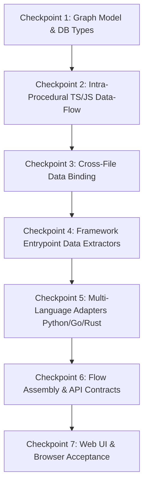

# GitHow — Phase 5: Data-Flow Intelligence
## Architecture, Scope Proposal, and Acceptance Plan

---

## 1. Executive Summary & Context

Phase 4 (**Framework Intelligence & Entry-Point Discovery**) established static route discovery across seven frameworks (Express, Fastify, Flask, FastAPI, Gin, Actix Web, Axum), persisting route hierarchies, hooks, plugins, and dependencies into the shared **Repository Intelligence Graph (RIG)**. Phase 4 was formally accepted with zero regressions (`docs/PHASE_4_ACCEPTANCE_REPORT.md`).

Phase 5 addresses **Data-Flow Intelligence**: tracing how values propagate from framework entry points, through local variable assignments and transformations, across function calls into parameters, and back through return expressions.

A critical design mandate of Phase 5 is maintaining the boundary between **control flow** and **data flow**:
- A `CALLS` edge represents an execution invocation: function $A$ calls function $B$. It provides **no guarantee** that any specific value propagates between $A$ and $B$.
- A `FLOWS_TO` or `RETURNS_TO` edge represents explicit value propagation supported by syntax and semantic evidence: value $x$ at source expression $S$ is bound to parameter or variable $y$ at target expression $T$.

This document outlines the bounded capability, graph model extensions, static-analysis algorithms, test strategies, and quality gates for Phase 5 prior to any production code implementation.

---

## 2. Current Architecture Findings

Inspection of the active codebase reveals the following established components and integration surfaces:

### 2.1 Shared Repository Intelligence Graph (RIG)
- **Model Definition:** `packages/analyzer/src/model.ts`
  - Current `NodeType`: `'snapshot' | 'file' | 'symbol' | 'module' | 'route'`.
  - Current `EdgeType`: `'CONTAINS' | 'IMPORTS' | 'EXPORTS' | 'DECLARES' | 'CALLS' | 'EXTENDS' | 'IMPLEMENTS' | 'ROUTE_HANDLER' | 'MIDDLEWARE' | 'MOUNTS' | 'DEPENDS_ON' | 'HOOK' | 'PLUGIN'`.
  - Current `ResolutionStatus`: `'resolved' | 'unresolved' | 'ambiguous' | 'observed'`.
  - Deterministic ID construction:
    - Node IDs: `createNodeId(snapshot, type, key, version)` $\rightarrow$ SHA-256 over `(schemaVersion, version, snapshot, type, key)`.
    - Edge IDs: `createEdgeId(snapshot, type, from, to, version, evidence)` $\rightarrow$ SHA-256 over `(schemaVersion, version, snapshot, type, from, to, evidence.path, evidence.startLine, evidence.startColumn)`.
  - Node and edge sets are sorted by deterministic `id` prior to returning `AnalysisResult`.

### 2.2 Language Adapters
- **TypeScript/JavaScript (`packages/analyzer/src/analyzer.ts`):**
  - Uses the official TypeScript compiler AST (`ts.createSourceFile`, `ts.forEachChild`).
  - Strict compliance with `AGENTS.md`: "uses the TypeScript compiler AST for the current TypeScript/JavaScript scope behind the analyzer's internal parser boundary (rather than regular-expression parsing)".
  - Extracts classes, methods, functions, variables, exports, imports, and calls.
- **Python (`packages/analyzer/src/adapters/python.ts`):**
  - Uses Web Tree-sitter (`tree-sitter-python.wasm`) via `packages/analyzer/src/treesitter.ts`.
  - Extracts definitions, decorated definitions (`@app.route`, `@bp.before_request`), imports, and symbol invocations.
- **Go (`packages/analyzer/src/adapters/go.ts`):**
  - Uses Web Tree-sitter (`tree-sitter-go.wasm`).
  - Extracts packages, structs, methods with receiver binding, functions, calls, and Gin router groups.
- **Rust (`packages/analyzer/src/adapters/rust.ts`):**
  - Uses Web Tree-sitter (`tree-sitter-rust.wasm`).
  - Extracts modules, functions, impl blocks, macro invocations (`actix_web::get`), and Axum router chains.

### 2.3 Cross-File Resolution System
- **Path & Specifier Resolution (`packages/analyzer/src/resolution.ts`):**
  - `resolveTsModule`: Resolves relative imports (`./foo`, `../bar`), `.js` to `.ts`/`.tsx` mapping, and barrel `index.ts`/`index.js` resolution against `allFilesSet`.
  - `resolvePythonModule`: Handles dot-prefixed relative imports and package-root absolute lookups.
  - `resolveGoPackageImport`: Reads `go.mod` module identity and resolves package directory paths.
  - `resolveRustModuleFile`: Resolves `mod.rs` and file-named modules.
- **Fixed-Point Iteration (`packages/analyzer/src/analyzer.ts:205-299`):**
  - Up to 10 iterations resolving local exports, re-exports (`export * from ...`, `export { a as b }`, namespace exports), and updating `importedBindings` until a fixed point is reached.

### 2.4 Framework Adapters & Route Discovery
- Located in `packages/analyzer/src/frameworks/`:
  - `express.ts`, `fastify.ts`, `flask.ts`, `fastapi.ts`, `gin.ts`, `actix.ts`, `axum.ts`.
  - Discover `route` nodes and link them to handlers and middleware with source evidence (file path, line ranges, HTTP method, route path).

### 2.5 Flow Assembly & Graph Persistence
- **Flow Discovery (`packages/analyzer/src/flow.ts`):**
  - `findFlowCandidates`: Identifies routes and constructs flow candidate objects.
  - `assembleFlow`: Traverses outgoing relationships starting from a candidate route node through `ROUTE_HANDLER`, `MIDDLEWARE`, `DEPENDS_ON`, `HOOK`, `PLUGIN`, `MOUNTS`, and `CALLS`.
  - Enforces traversal bounds: `maxDepth: 8`, `maxFanOut: 6`, `maxSteps: 80`.
- **Database (`packages/db/src/schema.ts`, `packages/db/src/repository.ts`):**
  - `graph_nodes.nodeType` and `graph_edges.edgeType` are stored as `text` columns in PostgreSQL, allowing edge type additions without database-level DDL migrations or lock contention.
  - Unique index enforces idempotency: `(snapshot_id, analyzer_version, schema_version, edge_type, from_node_id, to_node_id, id)`.
- **API (`apps/api/src/app.ts`):**
  - Provides `/snapshots/:id/graph`, `/snapshots/:id/nodes/:nodeId/neighborhood`, `/snapshots/:id/flows`, `/snapshots/:id/flows/:flowId`, and `/snapshots/:id/source`.

### 2.6 React Flow Workspace
- **Web App (`apps/web/app/components/GitFlowGraph.tsx`, `GitFlowNode.tsx`):**
  - Dagre hierarchical layout (`LR`).
  - View modes: `flow` (step-by-step traversal) and `full` (complete RIG).
  - Progressive neighborhood expansion via `/snapshots/:id/nodes/:nodeId/neighborhood`.
  - Source code panel highlights evidence line ranges upon node selection.

---

## 3. Bounded Phase 5 Capability

Phase 5 introduces static value-flow extraction with strict boundaries. It does not perform dynamic runtime tracing, symbolic execution, abstract interpretation, or whole-program points-to analysis.

```mermaid
flowchart LR
    subgraph EntryPoint ["1. Framework Entrypoint"]
        RouteNode["route: GET /users/:id"]
        ReqParam["symbol: req.params.id<br/>(payload source)"]
        RouteNode -->|ORIGINATES| ReqParam
    end

    subgraph LocalHandler ["2. Route Handler Scope"]
        HandlerParam["symbol: id (local var)"]
        ReqParam -->|FLOWS_TO<br/>(destructure)| HandlerParam
        Transform["symbol: normalizedId"]
        HandlerParam -->|FLOWS_TO<br/>(transform)| Transform
    end

    subgraph ServiceCall ["3. Cross-File Call Boundary"]
        CallArg["symbol: arg0 (call site)"]
        Transform -->|FLOWS_TO| CallArg
        CalleeParam["symbol: userId (param)"]
        CallArg -->|FLOWS_TO<br/>(cross-file)| CalleeParam
    end

    subgraph CalleeScope ["4. Callee Function & Return"]
        CalleeReturn["symbol: userRecord<br/>(return expr)"]
        CalleeParam -.->|logic| CalleeReturn
    end

    subgraph ResponseSink ["5. Caller Assignment & Sink"]
        CallerDest["symbol: user (result var)"]
        CalleeReturn -->|RETURNS_TO<br/>(cross-file)| CallerDest
        ResponseSend["symbol: res.json(user)<br/>(terminal sink)"]
        CallerDest -->|FLOWS_TO| ResponseSend
    end

    classDef ep fill:#eff6ff,stroke:#3b82f6,stroke-width:2px;
    classDef sym fill:#f0fdf4,stroke:#10b981,stroke-width:2px;
    classDef ret fill:#fdf4ff,stroke:#a855f7,stroke-width:2px;
    classDef unres fill:#fff7ed,stroke:#f97316,stroke-width:2px,stroke-dasharray: 5 5;

    class RouteNode,ReqParam ep;
    class HandlerParam,Transform,CallArg,CalleeParam,CallerDest,ResponseSend sym;
    class CalleeReturn ret;
```

### 3.1 The Six Supported Data-Flow Patterns
1. **Function Argument to Parameter Relationships:**
   - Call expressions `func(arg0, arg1)` bind each argument value directly to the formal parameter symbol of the resolved function declaration (`param0`, `param1`).
2. **Local Variable Assignments & Direct Value Transformations:**
   - Direct assignments: `const a = b`.
   - Property accesses: `const a = b.c`.
   - Destructuring patterns: `const { id, name } = req.body`.
   - Basic unary/binary transformations: `const upper = id.toUpperCase()`, `const full = first + ' ' + last`.
3. **Function Return Values & Calling Expressions:**
   - Return statements `return val;` inside a callee bind directly to the caller's receiving assignment variable `const res = func();`.
   - Multiple return points fan-in to the caller receiver variable, with evidence preserving each branch source location.
4. **Bounded Propagation Across Existing Cross-File Function Relationships:**
   - Uses the existing cross-file declaration indices and module resolvers (`resolveTsModule`, `resolvePythonModule`, etc.).
   - Follows data across module boundaries up to a strict call depth limit.
5. **Data Paths Originating From Supported Framework Entry Points:**
   - Express/Fastify: `req.params`, `req.query`, `req.body`, `req.headers`.
   - FastAPI: Type-annotated path parameters, query parameters, and Pydantic request bodies.
   - Flask: `request.args`, `request.form`, `request.json`, `request.view_args`.
   - Gin: `c.Param()`, `c.Query()`, `c.ShouldBindJSON()`.
   - Actix Web / Axum: `Path<T>`, `Query<T>`, `Json<T>` extractors.
6. **Explicitly Unresolved Relationships:**
   - Dynamic property indexing `obj[computedKey]`.
   - Calls to unresolved external packages or unknown modules.
   - Reflective invocations (`eval`, `getattr`, `reflect`).
   - Higher-order callbacks without identifiable static dispatch.
   - When propagation cannot be verified, an edge or node with `resolution: 'unresolved'` is emitted, containing `evidence.reason` explaining the exact cause.

---

## 4. Proposed Graph-Model Extensions

To avoid fragmentation or breaking changes to existing database queries and frontend renderers, the graph schema will extend existing types conservatively.

### 4.1 Node Types
The existing `NodeType = 'snapshot' | 'file' | 'symbol' | 'module' | 'route'` is **retained without modification**.

Data-flow entities are modeled as `symbol` nodes, distinguished via structured `SourceEvidence.attributes`:
- **Function Parameter Node:**
  - `type`: `'symbol'`
  - `key`: `${filePath}:${startPos}:${enclosingFunction}:${paramName}`
  - `evidence.attributes`: `{ kind: 'parameter', functionName: '...', parameterIndex: 0 }`
- **Return Value Node:**
  - `type`: `'symbol'`
  - `key`: `${filePath}:${startPos}:${enclosingFunction}:return`
  - `evidence.attributes`: `{ kind: 'return', functionName: '...' }`
- **Local Variable / Intermediate Transformation Node:**
  - `type`: `'symbol'`
  - `key`: `${filePath}:${startPos}:${variableName}`
  - `evidence.attributes`: `{ kind: 'variable', scope: '...' }`
- **Entrypoint Payload Node:**
  - `type`: `'symbol'`
  - `key`: `${filePath}:${startPos}:${routeId}:${sourceKind}`
  - `evidence.attributes`: `{ kind: 'entrypoint_payload', source: 'params' | 'query' | 'body' | 'header', fieldName?: 'id' }`

### 4.2 Edge Types
Extend `EdgeType` in `packages/analyzer/src/model.ts` with two specific data-flow edge types:

```typescript
export type EdgeType =
  | 'CONTAINS'
  | 'IMPORTS'
  | 'EXPORTS'
  | 'DECLARES'
  | 'CALLS'
  | 'EXTENDS'
  | 'IMPLEMENTS'
  | 'ROUTE_HANDLER'
  | 'MIDDLEWARE'
  | 'MOUNTS'
  | 'DEPENDS_ON'
  | 'HOOK'
  | 'PLUGIN'
  // Phase 5 Data-Flow Edges:
  | 'FLOWS_TO'     // Direct value propagation (source -> target)
  | 'RETURNS_TO';  // Callee return value -> caller assignment target
```

#### Edge Attributes Schema (`evidence.attributes`)
- **`FLOWS_TO`**:
  - `channel`: `'argument_pass' | 'assignment' | 'transformation' | 'destructure' | 'entrypoint'`
  - `parameterIndex`: number (for argument passing)
  - `transformation`: `'identity' | 'property_access' | 'destructure' | 'call' | 'binary_expr'`
  - `property`: string (e.g., `'id'` for `req.params.id`)
- **`RETURNS_TO`**:
  - `channel`: `'return_value'`
  - `callSitePath`: string
  - `callSiteLine`: number

### 4.3 Database Schema Impact
- **No Postgres DDL Migration Required:** In `packages/db/src/schema.ts`, `graph_edges.edgeType` is defined as `text('edge_type')`.
- **Test Alignment:** Update `packages/db/src/schema.test.ts` to include `'FLOWS_TO'` and `'RETURNS_TO'` in the supported edge type list.

---

## 5. Analysis and Resolution Strategy

### 5.1 Intra-Procedural Data-Flow Pass (Per Function Scope)
Within each parsed function or route handler body:
1. **Identifier Def-Use Tracker:**
   - Track local declarations (`const`, `let`, `var`, parameter bindings).
   - Record the expression assigned to each identifier.
2. **Entrypoint Parameter Binding:**
   - For Express/Fastify handlers `(req, res)`:
     - Inspect property accesses on `req.params`, `req.query`, `req.body`, `req.headers`.
     - Inspect destructuring patterns: `const { id } = req.params`.
     - Emit an entrypoint payload symbol and link it to the local variable via `FLOWS_TO (channel: 'entrypoint')`.
   - For Python/Go/Rust:
     - Map framework extractor parameters (e.g. FastAPI `user_id: int`, Gin `c.Param("id")`, Actix `Path(id)`) to the handler parameter symbol.
3. **Expression Transformations:**
   - If variable `b` is assigned `a`: emit `a FLOWS_TO b (channel: 'assignment', transformation: 'identity')`.
   - If variable `b` is assigned `a.foo`: emit `a FLOWS_TO b (channel: 'assignment', transformation: 'property_access', property: 'foo')`.
   - If variable `b` is assigned `transform(a)`: emit `a FLOWS_TO b (channel: 'transformation', transformation: 'call')`.
4. **Call Site Argument Association:**
   - For call expression `callee(arg0, arg1)`:
     - Check whether `arg0` resolves to a local variable `v`.
     - Emit edge: `v FLOWS_TO <callee:param0>`.
5. **Return Point Collection:**
   - For `return expr;`:
     - Resolve `expr` to its local variable or value source.
     - Emit edge: `expr FLOWS_TO <currentFunction:return>`.

### 5.2 Inter-Procedural & Cross-File Binding Pass
1. **Target Declaration Lookup:**
   - Reuses `declarations` and `importedBindings` maps from the multi-pass fixed-point resolution in `analyzer.ts`.
   - Resolves `callee` to its declaration symbol ID (whether in the same file or an imported file).
2. **Parameter Matching:**
   - Inspect the target function's parameter list.
   - Bind positional argument index $i$ to parameter $i$.
   - If argument count exceeds declared parameters (e.g. variadic or optional), bind up to known parameters and flag rest as `unresolved`.
   - If the callee is an external package (not in repository manifest), emit a data-flow edge targeting an `unresolved-symbol` with `resolution: 'unresolved'` and `evidence.reason: 'target function is in an external package'`.
3. **Return-to-Caller Stitching:**
   - Find all return expressions of the target function.
   - If caller assigned the call result `const out = callee(...)`, emit `callee:return RETURNS_TO out`.

### 5.3 Bound Enforcement & Cycle Safety
To guarantee termination, bounded runtimes, and prevent cyclic graph explosions:
- **Call Depth Bound:** Data flow traversal across function calls terminates at a maximum depth of **5 hops**.
- **Cycle-Breaking Set:** Maintain an active path set of `(functionSymbolId, parameterIndex)` tuples. If a function is revisited on the current call stack (recursion), terminate propagation with `evidence.attributes.cycleDetected = true`.
- **Fan-Out & Step Limit:** Maximum of **40 data-flow steps** per discovered flow.
- **Determinism:** Pre-sort source files and emit edges using the deterministic `createEdgeId` hash.

---

## 6. API and UI Integration Strategy

### 6.1 API Contracts (`apps/api`)
1. **Flow Query Extension:**
   - Existing endpoint `GET /snapshots/:id/flows/:flowId` returns `DiscoveredFlow`.
   - Extend `DiscoveredFlow` to include data-flow edges and steps:
     ```typescript
     export interface DiscoveredFlow {
       id: string;
       snapshotId: string;
       candidate: FlowCandidate;
       steps: FlowStep[];
       relationships: FlowRelationship[];
       dataRelationships?: FlowRelationship[]; // FLOWS_TO and RETURNS_TO edges
       dataSteps?: FlowStep[];                 // Parameter, variable, return nodes
       truncated: boolean;
       limitations: string[];
     }
     ```
   - Query parameter support: `GET /snapshots/:id/flows/:flowId?view=data|control|all` (defaults to `all` for seamless client-side filtering).
2. **Neighborhood Endpoint:**
   - Existing endpoint `GET /snapshots/:id/nodes/:nodeId/neighborhood` automatically returns `FLOWS_TO` and `RETURNS_TO` edges because it queries the underlying `graph_edges` table without edge-type restrictions.

### 6.2 React Flow Workspace (`apps/web`)
1. **Dual Flow Selector (Control vs. Data Flow):**
   - Add a segmented control in the top-right toolbar:
     - `Control Flow` (handler $\rightarrow$ middleware $\rightarrow$ calls $\rightarrow$ downstream)
     - `Data Flow` (entrypoint $\rightarrow$ params $\rightarrow$ transforms $\rightarrow$ returns $\rightarrow$ sink)
     - `Combined View` (both overlays with distinct edge styles)
2. **Visual Differentiation in `GitFlowGraph.tsx`:**
   - `FLOWS_TO` edges: Solid cyan stroke (`#0284c7`), arrow marker, animated forward flow.
   - `RETURNS_TO` edges: Solid purple stroke (`#9333ea`), dashed arrow marker, animated backward flow.
   - `unresolved` data-flow edges: Dashed amber stroke (`#f59e0b`) with a `⚠ unresolved` badge.
3. **Node Badging in `GitFlowNode.tsx`:**
   - Parameter symbols display a `param` badge (`#0284c7`).
   - Return symbols display a `return` badge (`#9333ea`).
   - Variable symbols display a `var` badge (`#10b981`).
4. **Source Code Inspector Synchronization:**
   - Clicking a `FLOWS_TO` edge highlights both the producer line and consumer line in the source viewer.

---

## 7. Evidence-Based Test Plan

All tests will verify actual node IDs, edge types, source evidence paths, line coordinates, and resolution states—never relying solely on coarse edge counts.

### 7.1 Unit Tests (`packages/analyzer/src/analyzer.test.ts`)
1. **Local Variable Flow:**
   - `const a = 1; const b = a;`
   - Verify `FLOWS_TO` from `a` to `b` with `channel: 'assignment'`.
2. **Destructuring Flow:**
   - `const { x, y } = getPoint();`
   - Verify `FLOWS_TO` from `getPoint()` to `x` (property `'x'`) and `y` (property `'y'`).
3. **Transformation Flow:**
   - `const upper = name.trim().toUpperCase();`
   - Verify chained transformation data edges with line evidence.
4. **Intra-File Argument Passing:**
   - `function helper(val) { ... } helper(myVar);`
   - Verify `myVar FLOWS_TO helper.val` with `parameterIndex: 0`.
5. **Intra-File Return Value:**
   - `function compute() { return 42; } const res = compute();`
   - Verify `compute:return RETURNS_TO res`.
6. **Cross-File Flow Resolution:**
   - File `a.ts` calls `processData(input)` in `b.ts`.
   - Verify `input FLOWS_TO processData.data` cross-file edge.
   - Verify `processData:return RETURNS_TO a.output` cross-file return edge.
7. **Unresolved External Call:**
   - `const hash = crypto.createHash(algo);` where `crypto` is an unanalyzed external module.
   - Verify `FLOWS_TO` edge emitted with `resolution: 'unresolved'` and reason `'target function is in an external package'`.
8. **Recursion & Cycle Safety:**
   - `function recurse(n) { if (n <= 0) return 0; return recurse(n - 1); }`
   - Verify propagation halts cleanly without infinite loop or stack overflow, producing deterministic graph output.
9. **Determinism Verification:**
   - Analyze files in forward order, then reverse order.
   - Assert identical SHA-256 node and edge IDs.

### 7.2 Framework Entrypoint Tests (`packages/analyzer/src/`)
1. **Express Request Parameter Flow:**
   - `app.get('/users/:id', (req, res) => { const userId = req.params.id; getUser(userId); });`
   - Verify data flow from `req.params.id` $\rightarrow$ `userId` $\rightarrow$ `getUser.id`.
2. **Fastify Request Body Flow:**
   - `fastify.post('/items', async (req) => { saveItem(req.body); });`
   - Verify data flow from `req.body` $\rightarrow$ `saveItem.item`.
3. **FastAPI Path & Query Flow:**
   - `@app.get("/items/{item_id}") def read_item(item_id: int, q: str = None): return search(item_id, q)`
   - Verify Python Tree-sitter adapter binds `item_id` and `q` to `search` arguments.
4. **Flask Form Flow:**
   - `@app.route('/login', methods=['POST']) def login(): user = request.form['username']`
   - Verify Flask extractor binds `request.form['username']` to `user`.
5. **Gin Param Flow:**
   - `r.GET("/user/:name", func(c *gin.Context) { name := c.Param("name"); find(name); })`
   - Verify Go adapter binds `c.Param` return to `find.name`.
6. **Actix & Axum Extractor Flow:**
   - `async fn get_user(Path(user_id): Path<u32>) -> impl IntoResponse { query(user_id) }`
   - Verify Rust adapter binds `user_id` to `query`.

### 7.3 Real-Repository Acceptance Scenarios
1. **Express Real Repository (`expressjs/express` at commit `818a72a0889ec1870f7a0dc4f676451631584cfc`):**
   - Source: `examples/route-separation/index.js` and `user.js`.
   - Entrypoint: `GET /user/:id`.
   - Target: Trace `req.params.id` from `index.js:33` into `user.load(id, fn)` in `user.js:34`.
   - Verify cross-file argument binding and parameter resolution.
2. **FastAPI Real Repository (`fastapi/fastapi` at commit `3f23a13b63d6b052efdcfbd6510d7a6e115049fb`):**
   - Source: `docs_src/bigger_applications/app/routers/users.py`.
   - Entrypoint: `GET /users/{username}`.
   - Target: Trace `username` parameter into handler logic.

### 7.4 Persistence & API Retrieval Tests
- **Database (`packages/db`):**
  - Live PostgreSQL test verifying `FLOWS_TO` and `RETURNS_TO` persistence, deduplication, and retrieval with full evidence.
- **API (`apps/api`):**
  - Verify `/snapshots/:id/flows/:flowId` returns data-flow steps and relationships with valid types.

### 7.5 Browser Interactive Acceptance
- Automated session via `browser_subagent`:
  - Open `http://localhost:3000/expressjs/express`.
  - Select route `GET /user/:id`.
  - Switch view mode to `Data Flow`.
  - Verify cyan `FLOWS_TO` edges render with parameter badges.
  - Select edge and inspect evidence in source code viewer.
  - Verify zero console errors and clean Dagre layout.

---

## 8. Acceptance Criteria

Phase 5 completion requires satisfying all criteria across six distinct gates:

### Gate 1: Unit & Language Adapter Acceptance
- [ ] TypeScript compiler AST extracts argument, parameter, variable, and return symbols with exact line/column evidence.
- [ ] Python, Go, and Rust adapters extract entrypoint parameters and bind basic local variable flows.
- [ ] Intra-procedural assignment, destructuring, and property access correctly emit `FLOWS_TO`.
- [ ] Return statements correctly emit `RETURNS_TO`.
- [ ] All unit tests pass (`pnpm --filter @gitflow/analyzer test`).

### Gate 2: Cross-File Resolution Acceptance
- [ ] Cross-file calls bind argument symbols to imported function parameter symbols.
- [ ] Cross-file return values bind callee return symbols to caller assignment targets.
- [ ] Unresolved external or dynamic calls preserve `resolution: 'unresolved'` with explicit reasons.
- [ ] Deterministic IDs are verified on reversed file traversal.

### Gate 3: Database & API Acceptance
- [ ] `packages/db` integration tests pass with live PostgreSQL 17 on port 5433 (`INTEGRATION=1`).
- [ ] `FLOWS_TO` and `RETURNS_TO` edges persist and round-trip without loss of evidence or resolution status.
- [ ] API endpoints `/snapshots/:id/flows` and `/snapshots/:id/flows/:flowId` return bounded data-flow steps and relationships.

### Gate 4: Browser Acceptance
- [ ] React Flow workspace displays data-flow relationships in `Data Flow` mode.
- [ ] Nodes display appropriate semantic badges (`param`, `var`, `return`).
- [ ] Edges display distinct styling (`#0284c7` for `FLOWS_TO`, `#9333ea` for `RETURNS_TO`, dashed for `unresolved`).
- [ ] Neighborhood expansion dynamically loads connected data-flow nodes.
- [ ] Zero uncaught console errors during interactive browsing.

### Gate 5: Regression & Monorepo Gates
- [ ] `pnpm typecheck` passes cleanly across all 10 packages.
- [ ] `pnpm test` passes cleanly across all monorepo test suites.
- [ ] `pnpm build` produces clean production builds for all packages and apps (including Next.js).
- [ ] `git diff --check` reports zero whitespace or formatting errors.
- [ ] Existing Phase 4 framework discovery (all 7 frameworks) passes with zero regressions.

### Gate 6: Honest Reporting of Limitations
- [ ] Dynamic reflection, pointer aliasing, and complex heap mutations are explicitly documented as unsupported rather than falsely marked resolved.

---

## 9. Explicit Out-of-Scope Items

To keep Phase 5 bounded, reliable, and strictly aligned with platform rules:
1. **No Taint Analysis / Security Scanning:** GitHow does not categorize data as "tainted" or report vulnerability CVEs. It traces repository structure and semantic data flow.
2. **No Whole-Program Alias Analysis:** Mutable heap aliases (e.g. `objA.field = x; objB = objA; read(objB.field)`) beyond direct local references are marked unresolved.
3. **No Dynamic Execution / Eval:** No runtime code execution, sandboxing, or eval-based analysis.
4. **No LLM Code Inferences:** All nodes and edges must be provably backed by source code AST evidence.
5. **No Graph or Vector Database:** All graph persistence remains in PostgreSQL via `@gitflow/db`.
6. **No Additional Languages or Frameworks:** Retains the existing 4 languages (TS/JS, Python, Go, Rust) and 7 frameworks.
7. **No UI Redesign:** Enhances the existing React Flow workspace and source viewer without adding disconnected pages or diagrams.

---

## 10. Implementation Sequence and Dependencies

The implementation will proceed in seven discrete, testable checkpoints:



1. **Checkpoint 1: Graph Model & DB Schema Typing (`packages/analyzer`, `packages/db`)**
   - Add `'FLOWS_TO'` and `'RETURNS_TO'` to `EdgeType` in `model.ts`.
   - Update `packages/db/src/schema.test.ts`.
2. **Checkpoint 2: Intra-Procedural TS/JS Data-Flow (`packages/analyzer`)**
   - Implement local identifier def-use analysis in `analyzer.ts`.
   - Extract assignments, destructuring, property accesses, and return values.
   - Unit tests for local flow.
3. **Checkpoint 3: Cross-File Data Binding (`packages/analyzer`)**
   - Connect call arguments to imported function parameters and returns back to callers.
   - Enforce depth (5 hops) and cycle limits.
   - Unit tests for cross-file data resolution.
4. **Checkpoint 4: Framework Entrypoint Data Extractors (`packages/analyzer/src/frameworks`)**
   - Enhance Express, Fastify, Flask, FastAPI, Gin, Actix, Axum to emit entrypoint payload symbols and initial `FLOWS_TO` edges.
5. **Checkpoint 5: Multi-Language Adapter Data Flow (`packages/analyzer/src/adapters`)**
   - Implement parameter and return binding in Python, Go, and Rust Tree-sitter adapters.
6. **Checkpoint 6: Flow Assembly & API Contracts (`packages/analyzer/src/flow.ts`, `apps/api`)**
   - Extend `assembleFlow` to support data-flow relationships and dual-view assembly.
   - Update API contracts and test coverage.
7. **Checkpoint 7: React Flow UI & Browser Acceptance (`apps/web`)**
   - Implement Data Flow view mode, edge styling, and node badges.
   - Live browser validation session and documentation closure.

---

## 11. Risks and Known Limitations

1. **Aliased Mutation Risk:**
   - *Risk:* In JavaScript and Python, modifying an object property through an alias (e.g. `const b = a; b.x = 10;`) may lead to missing data edges if tracked naively.
   - *Mitigation:* Explicitly bound property propagation to direct assignments. Where mutative aliasing cannot be statically proven, emit an unresolved diagnostic or edge rather than guessing.
2. **Graph Size & Workspace Density:**
   - *Risk:* Generating symbols for every intermediate sub-expression could flood the React Flow canvas with hundreds of nodes.
   - *Mitigation:* Focus data-flow symbols strictly on function parameters, return points, entrypoint payloads, and named variables involved in the route-to-sink flow. Omit ephemeral intermediate AST nodes (e.g. literal constants, intermediate binary tokens).
3. **Variadic & Callback Arguments:**
   - *Risk:* Functions accepting variable arguments (`...args`) or callback functions (`cb(err, data)`) cannot always map arguments 1:1 by index.
   - *Mitigation:* Map known positional arguments; mark variadic tails or unresolvable higher-order callbacks as `unresolved` with clear evidence reasons.
4. **Rust Macro Route Extractor Types:**
   - *Risk:* Actix Web and Axum extractors rely on macro attributes or chained builders.
   - *Mitigation:* Bind data flow from explicit extractor function parameters (`Path(id)`, `Json(body)`), avoiding speculative macro expansion.

---

## 12. Verification and Sign-Off Request

This planning document is delivered at:
`docs/PHASE_5_DESIGN.md`

No production code, database schema migrations, or application runtime behaviors have been modified during this planning task. Implementation will commence only upon explicit user review and approval of this plan.
